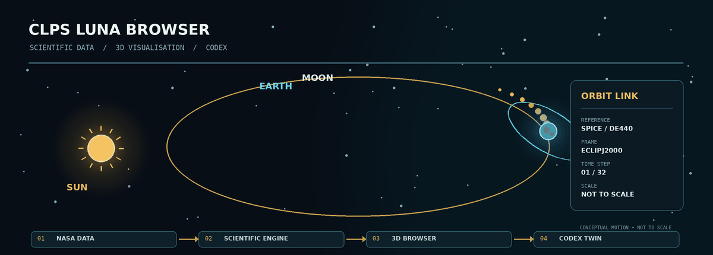
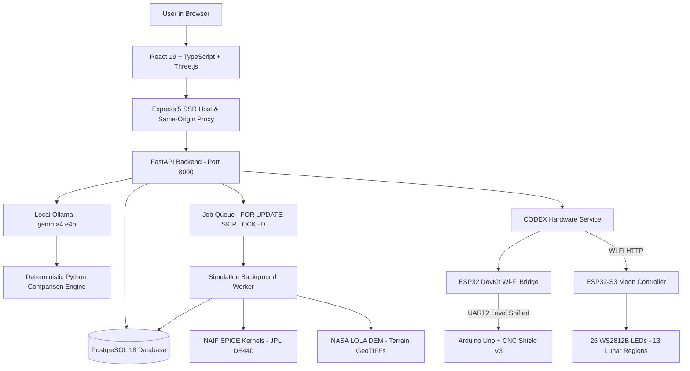

<div align="center">
  

  <h1>CLPS Luna Browser</h1>
  <p><strong>Integrated Lunar Landing-Site Analysis, Scientific Simulation &amp; CODEX Hardware Demonstrator</strong></p>

  <p>
    <strong>📊 Presentation:</strong>
    <a href="https://github.com/SidzArt/CLPS-Lunar-Module/blob/main/CLPS_Luna_Browser.pdf"><strong>View in GitHub</strong></a>
    &nbsp;•&nbsp;
    <a href="https://drive.google.com/file/d/1MlSr--QFZDucx_buuiSCgR9ZnE70mANq/view?usp=sharing"><strong>Google Drive Download</strong></a>
    &nbsp;&nbsp;&nbsp;|&nbsp;&nbsp;&nbsp;
    <strong>📄 Technical Report:</strong>
    <a href="https://github.com/SidzArt/CLPS-Lunar-Module/blob/main/Report.pdf"><strong>View in GitHub</strong></a>
    &nbsp;•&nbsp;
    <a href="https://drive.google.com/file/d/1n_NYg4LGkDMiyQO1JD48y9mleXAieac6/view?usp=sharing"><strong>Google Drive Download</strong></a>
    &nbsp;&nbsp;&nbsp;|&nbsp;&nbsp;&nbsp;
    <strong>📑 Documentation:</strong>
    <a href="https://github.com/SidzArt/CLPS-Lunar-Module/blob/main/Documentation.pdf"><strong>View in GitHub</strong></a>
    &nbsp;•&nbsp;
    <a href="https://drive.google.com/file/d/1DExu2Gtc921Ij5vPSVqp_Mm3_VfYO06-/view?usp=sharing"><strong>Google Drive Download</strong></a>
  </p>

  <p>
    
    
    
    
    
    
    
    
  </p>
</div>

---

## 📑 Project Presentation & Technical Documentation Hub

| Document | Format | Description | GitHub Repository Viewer | Google Drive Direct Link |
| :--- | :--- | :--- | :--- | :--- |
| 📊 **CLPS Luna Browser Presentation** | PDF Slides | Complete 7-slide mission build and technical overview. | [Open in GitHub](https://github.com/SidzArt/CLPS-Lunar-Module/blob/main/CLPS_Luna_Browser.pdf) | [Download / View](https://drive.google.com/file/d/1MlSr--QFZDucx_buuiSCgR9ZnE70mANq/view?usp=sharing) |
| 📄 **Final Technical Project Report** | PDF Report | 17-page comprehensive technical report covering all subsystems, data contracts, and verification status. | [Open in GitHub](https://github.com/SidzArt/CLPS-Lunar-Module/blob/main/Report.pdf) | [Download / View](https://drive.google.com/file/d/1n_NYg4LGkDMiyQO1JD48y9mleXAieac6/view?usp=sharing) |
| 📑 **Integrated Project Documentation** | PDF Docs | 6-page project overview, architecture, constraints, and operational guidelines. | [Open in GitHub](https://github.com/SidzArt/CLPS-Lunar-Module/blob/main/Documentation.pdf) | [Download / View](https://drive.google.com/file/d/1DExu2Gtc921Ij5vPSVqp_Mm3_VfYO06-/view?usp=sharing) |

---

## 🌒 What is CLPS Luna Browser?

**CLPS Luna Browser** is a research and scientific visualisation platform dedicated to evaluating candidate lunar landing sites around the Moon’s south pole. It combines:
1. **Interactive 3D Moon Browser:** Global and polar lunar navigation with Three.js / React Three Fiber.
2. **Structured Landing-Site Dossiers:** In-depth narratives, terrain parameters, scientific metrics, and high-resolution imaging.
3. **Deterministic Site Comparison:** Multi-criteria mission comparison with explicit missing-data handling.
4. **Local AI Assist:** Natural-language mission intent parsing powered by a locally hosted Ollama model (`gemma4:e4b`) with automatic deterministic fallback.
5. **Scientific Ephemeris & Terrain Simulation:** True Sun–Earth–Moon orbital geometry computed via NAIF SPICE kernels (JPL DE440) and NASA LOLA digital elevation models (DEM).
6. **CODEX Physical Hardware Demonstrator:** A physical 3-stage mechanical orrery and LED-illuminated lunar globe demonstrating Sun–Earth–Moon alignment and regional touchdown targeting.

> **Project Boundary & Disclaimer:** CLPS Luna Browser is a research, educational, and demonstration tool. It is not NASA-certified, flight-qualified, or an operational landing-site hazard avoidance system. Geometric visibility does not constitute a communications link budget, nor does solar line-of-sight guarantee lander solar array power yield.

---

## 📍 Lunar South Pole Candidate Landing Sites Catalogue

The platform integrates a curated catalogue of **9 lunar south-pole exploration sites** stored in PostgreSQL. Data depth strictly reflects verified scientific sources:

| Code | Landing Site | Coordinates (IAU MOON_ME) | Detail Level | Scientific Focus / Description |
| :---: | :--- | :--- | :---: | :--- |
| **1** | **Peak near Cabeus B** | 83.6°S, 68.8°W *(291.2°E)* | **Detailed Profile** | High-elevation polar ridge providing extended solar visibility, direct-to-Earth communications, and proximity to volatile cold traps in Cabeus crater. Full dossier with 3 high-res scientific plates. |
| **2** | **Haworth** | 86.9°S, 4.0°W *(alt: 87.45°S, 5.2°W)* | **Detailed Profile** | Permanently Shadowed Region (PSR) floor and rim with ultra-cold temperatures (~40 K) and high water-ice deposition probability. Full dossier with 3 high-res scientific plates. |
| **3** | **Malapert Massif** | ~86.4°S, 1.3°E | **Compact Record** | Prominent topographic high offering high earth-visibility duty cycles and strategic relay potential. |
| **4** | **Mons Mouton Plateau** | 84.6°S, 31.0°E | **Compact Record** | Large elevated flat plateau targeted for early polar roving and subsurface drilling missions. |
| **5** | **Nobile Rim 2** | 84.20°S, 60.70°E | **Compact Record** | Crater rim exploration zone characterised by low surface slopes and volatile prospecting terrain. |
| **6** | **Connecting Ridge** | ~89.6°S, 172.7°W *(187.3°E)* | **Compact Record** | Extreme polar ridge offering quasi-continuous summer illumination adjacent to Shackleton crater. |
| **7** | **Connecting Ridge Extension**| ~89.2°S, 86.0°W *(274.0°E)* | **Compact Record** | Topographic continuation connecting Shackleton rim to de Gerlache crater systems. |
| **8** | **Leibnitz Beta Plateau** | ~85.2°S, 33.8°E | **Compact Record** | Broad elevated massif with favorable regional radar and altimetry coverage. |
| **9** | **Amundsen Rim** | ~84.2°S, 66.9°E | **Compact Record** | High rim terrain offering deep PSR exploration access and long-baseline communications. |

### 🔒 Scientific Data Integrity Contract
- **No Fabricated Data:** Sites 1 & 2 possess full scientific dossiers, multi-section narratives, pros/cons, and metrics. Sites 3–9 are recorded strictly with their authoritative names and coordinates.
- **Explicit Missing-Data States:** When comparing sites, missing parameters are marked `Data unavailable` (never 0 or silently imputed).
- **No Forced Winners:** The comparison engine explicitly outputs `Insufficient data for a scientifically reliable recommendation` when compatible metrics do not exist for both candidates.

---

## 🗺️ Product Scope & 7-Step User Journey

```
   [1. Intro] ──▶ [2. Browse Moon] ──▶ [3. Read Dossier] ──▶ [4. Compare Sites]
                                                                     │
   [7. CODEX] ◀── [6. Orbit Simulation] ◀── [5. AI Assist] ◀─────────┘
```

| Step | User Action | System Response |
| :---: | :--- | :--- |
| **1. Intro** | Access root URL. Scroll through mission briefing. | Express SSR serves fast HTML; client initiates interactive 3D Moon rotating with scroll progress. |
| **2. Browse** | Rotate, zoom, and inspect markers on 3D Moon. | Interactive Three.js sphere highlights candidate landing sites and displays summary cards. |
| **3. Read** | Open a landing-site dossier. | Backend retrieves 6 structured workspaces: *Overview*, *History*, *Pros & Cons*, *Statistics*, *Gallery*, and *Research References*. |
| **4. Compare** | Select Site A and Site B, set mission objectives. | Deterministic Python scoring normalises weights and provides objective scientific recommendations. |
| **5. AI Assist** | State mission goals in natural language. | Local Ollama model parses intent into structured criteria; Python backend retrieves matching candidates. |
| **6. Simulate** | Select site, date range, duration, and playback speed. | Background simulation worker computes SPICE ephemerides and LOLA DEM horizon masking. |
| **7. CODEX** | Review hardware status and trigger physical run. | Backend validates command payload and commands the physical orrery and LED Moon globe. |

---

## 🏗️ System Architecture & Separation of Concerns



### Architectural Responsibilities & Boundaries

| Component | Technology Stack | Core Responsibility | Strict Boundary (Must NOT Do) |
| :--- | :--- | :--- | :--- |
| **Frontend UI** | React 19, TypeScript 5.8, Three.js 0.175 | Renders responsive UI, 3D Moon, and charts. | Never queries DB directly or invents ephemerides. |
| **SSR Server** | Express 5, Vite 7 SSR | Fast initial page load, SEO, same-origin proxy. | Does not contain business logic or motor control. |
| **Backend API** | FastAPI, Python 3.12, Pydantic v2 | Validates inputs, handles RBAC, orchestrates tasks. | Never blocks HTTP requests with long simulations. |
| **Database** | PostgreSQL 18, SQLAlchemy 2, Alembic | Stores sites, metrics, provenance, audits, users. | Never stores plaintext passwords or huge raw binaries. |
| **Simulation Worker** | SpiceyPy, NumPy, Rasterio, GDAL, PyProj | Calculates SPICE ephemerides and DEM line-of-sight. | Runs out-of-process in background worker thread. |
| **AI Assist** | Ollama (`gemma4:e4b`), JSON schema | Extracts structured requirements from prose. | Never scores, writes SQL, or invents facts. |
| **CODEX Service** | HTTP/JSON, HMAC-SHA256, UART | Validates commands and coordinates physical hardware. | Never treats a network ACK as physical motion proof. |

---

## 🔭 Scientific Simulation Engine (SPICE + LOLA DEM)

The scientific pipeline models celestial geometry and local lunar topography using rigorous astrodynamics:

1. **Ephemeris Time Conversion:** Converts UTC timestamps to Ephemeris Time (ET / Barycentric Dynamical Time) via `naif0012.tls`.
2. **State Calculation:** Queries JPL DE440 planetary ephemeris (`de440.bsp`) for Sun and Earth positions relative to the Moon center.
3. **Reference Frame Transformations:** Rotates vectors from inertial `ECLIPJ2000` to the Moon body-fixed `MOON_ME` (Mean Earth/Polar Axis) frame using `pck00011.tpc` and `moon_assoc_me.tf`.
4. **Topocentric Horizon Basis:** Converts body-fixed vectors into site-local East-North-Up (ENU) coordinates.
5. **LOLA DEM Terrain Horizon Masking:** Evaluates line-of-sight against Lunar Orbiter Laser Altimeter (LOLA) digital elevation grids (`LDEM_80S_80MPP_ADJ.TIF`). If a terrain feature intercepts the ray, the object is marked **terrain-occluded**.

---

## 🤖 Local AI Assist with Deterministic Safeguards

- **Intent Extraction Only:** The AI model processes user prompts like:
  > *"Compare sites for an early research mission prioritising water-ice prospecting, low slope, and direct Earth communication."*
- **Strict Pydantic JSON Contract:** The output is validated into structured weights: `{ "water_ice": 0.4, "slope": 0.3, "earth_visibility": 0.3 }`.
- **Deterministic Evaluation:** Python retrieves verified database rows and computes normalized dot-product scores.
- **Rule-Based Fallback:** If Ollama is offline or takes > 8s, keyword heuristics extract the intent seamlessly without user disruption.

---

## ⚙️ CODEX Physical Hardware Demonstrator

CODEX is a physical mechanical orrery and LED-mapped Moon globe that mirrors software simulation results in real space:

```
  [Stage 1: Sun Plate] ──▶ [Stage 2: Drive Base (NEMA 17 + BYJ)] ──▶ [Stage 3: Earth Plate + LED Moon Globe]
```

### Physical Subsystems
1. **Stage 1 — Sun / Illumination Plate:** Fixed optical reference lamp illuminating the orbital plane.
2. **Stage 2 — Slotted Machine Grid:** CNC-machined elliptical guide slot with NEMA 17 driving primary orbital arm and BYJ-48 stepper positioning the secondary Earth assembly.
3. **Stage 3 — Earth Plate & Moon Globe:** Rotating platform bearing Earth and a Moon globe equipped with **26 WS2812B addressable RGB LEDs** partitioned into **13 logical lunar regions**.

### Documented Hardware Pinout & Wiring

| Subsystem | Microcontroller | Pin / Interface | Electrical & Safety Notes |
| :--- | :--- | :--- | :--- |
| **Network Bridge** | ESP32 DevKit | Wi-Fi 802.11 b/g/n (Port 80) | Authenticated REST endpoints. |
| **Bridge ↔ Uno Serial** | ESP32 ↔ Arduino Uno | ESP32 GPIO 17 (TX) → Uno D0 (RX)<br>Uno D1 (TX) → ESP32 GPIO 16 (RX) | **115200 baud**; requires **bidirectional 3.3V ↔ 5V logic level shifter**. |
| **NEMA 17 Stepper** | Arduino Uno + CNC Shield V3 | **STEP: D2**, **DIR: D5**, **ENABLE: D8** | A4988 / DRV8825 carrier; active-low enable. Set Vref current limits. |
| **BYJ-48 Secondary** | Arduino Uno | **Option A:** ULN2003 (D10–D13)<br>**Option B:** Step/Dir (D4/D7) | Unipolar or bipolar configuration depending on hardware build. |
| **Hardware E-Stop** | Arduino Uno | **D3 (INT1)** (falling edge, `INPUT_PULLUP`) | Software trip + physical power disconnect to motor drivers. |
| **Moon LED Grid** | ESP32-S3 | **GPIO 48 (DIN)** | 26 WS2812B LEDs, GRB order, 800 kHz. External 5V rail (common ground). |

### Hardware Verification Status (Revision 1 Update)
- **Phase 5 Mechanical Issue:** Fully resolved.
- **Hardware Test Campaign:** 12 hardware integration tests conducted; **12/12 reported passed**.
- **Demonstration Mode:** UI includes dedicated live demonstration controls and hardware state inspection.

---

## 🧪 Testing, Quality & Security Audit

The software platform meets rigorous development quality gates:

| Verification Scope | Result | Coverage & Standards |
| :--- | :---: | :--- |
| **Backend Pytest Suite** | **115 Passed** | **91% Statement Coverage** across core logic, APIs, and services. |
| **Frontend React / Vitest** | **22 Passed** | Validates component states, forms, and render logic. |
| **Browser E2E (Playwright)** | **5 Passed** | End-to-end verification across Chrome, Firefox, and Safari. |
| **Type Integrity (TypeScript)** | **0 Errors** | Strict mode enabled across all frontend code. |
| **Python Static Analysis** | **Passed** | Ruff linting & Mypy strict type checking clean. |
| **Security / npm audit** | **0 Vulnerabilities** | Clean dependency tree; zero reported security flaws. |
| **Database Restore Audit** | **0 Mismatches** | Full restore verification across **45 tables / 4,097 rows**. |
| **Hardware Test Campaign** | **12/12 Passed** | Full multi-controller communication and motor actuation. |

---

## 🚀 One-Command Local Startup (`./run_clps.sh`)

The application includes an automated macOS launcher that validates prerequisites, starts all services in the proper dependency order, and displays the final URL:

```bash
# 1. Validate environment & dependencies
./run_clps.sh check

# 2. Start all services automatically
./run_clps.sh start

# 3. Check health and status of all processes
./run_clps.sh status

# 4. Stop all running background processes
./run_clps.sh stop
```

Once running, navigate to:
👉 **`http://localhost:3000`**

### Administrative Access (RBAC)

The Admin Portal is accessible via the top-left navigation on the Intro page.

| Role | Username | Password | Permissions |
| :--- | :--- | :--- | :--- |
| **Super Admin** | `test_super_admin` | `TestAdminPass123!` | Complete access: Site Editor, Media Management, Imports, Hardware Workbench, Firmware Editor, and Audit Logs. |
| **Viewer** | `test_viewer` | `TestViewerPass123!` | Read-only inspection of catalogue records, metrics, and system status. |

---

## 📂 Repository File Structure

```text
.
├── backend/
│   ├── alembic/              # Database migration history
│   ├── app/
│   │   ├── api/v1/           # FastAPI endpoints (sites, compare, ai-assist, simulation, codex, admin)
│   │   ├── core/             # App settings, security (Argon2id), audit logger
│   │   ├── db/               # PostgreSQL engine and session management
│   │   ├── integrations/     # SPICE (DE440), Terrain (LOLA DEM), Ollama, CODEX clients
│   │   ├── models/           # SQLAlchemy declarative database models
│   │   ├── repositories/     # Data access layer
│   │   ├── schemas/          # Pydantic v2 validation contracts
│   │   ├── services/         # Business logic (catalogue, comparison, simulation, hardware)
│   │   └── worker/           # Out-of-process simulation queue worker
│   ├── scripts/              # Ingestion scripts (ingest_south_pole_sites.py)
│   ├── storage/              # WebP media assets and dataset staging
│   └── tests/                # 115 Pytest integration and unit tests
├── frontend/
│   ├── server/               # Express 5 SSR server, security headers, proxy
│   ├── src/
│   │   ├── admin/            # Admin Console and RBAC guards
│   │   ├── api/              # Typed TanStack Query API fetchers
│   │   ├── components/       # Shared UI components (LunarSouthPoleSitesSection, Drawers)
│   │   ├── pages/            # IntroPage, BrowserPage, SiteInfoPage, ComparePage, AiAssistPage, SimulationPage, CodexPage
│   │   ├── styles/           # NASA-inspired dark theme CSS
│   │   └── three/            # Three.js 3D Moon canvas, shaders, celestial orbital scenes
│   └── tests/                # Vitest and Playwright test suites
├── firmware/
│   ├── esp32-wifi-bridge/    # ESP32 DevKit Wi-Fi REST-to-UART bridge
│   ├── arduino-uno-motion/   # Arduino Uno + CNC Shield V3 motor controller (AccelStepper)
│   └── esp32-s3-moon-led/    # ESP32-S3 Moon globe 26-LED controller (Adafruit_NeoPixel)
├── data/
│   ├── lunar-dem/            # NASA LOLA polar DEM GeoTIFF elevation grids
│   └── spice-kernels/        # NAIF SPICE planetary kernels (de440.bsp, leapseconds, frames)
├── CLPS_Luna_Browser.pdf     # Presentation Slides (PPT)
├── Report.pdf                # Final Technical Project Report (17 pages)
├── Documentation.pdf         # Integrated Project Documentation (6 pages)
├── Login_IDs.md              # Local administrative credentials and ports
├── run_clps.sh               # One-command macOS service launcher
└── Readme.md                 # Project README
```

---

## 📚 References & Scientific Sources

- [NASA Commercial Lunar Payload Services (CLPS)](https://www.nasa.gov/commercial-lunar-payload-services/)
- [NASA GSFC Planetary Geodesy Data Archive — LOLA Products](https://pgda.gsfc.nasa.gov/products/78)
- [NASA GSFC — South Pole LOLA DEM Mosaic (80 m/pixel)](https://pgda.gsfc.nasa.gov/products/81)
- [NAIF — Lunar SPICE Kernels & Documentation](https://naif.jpl.nasa.gov/naif/data_lunar.html)
- [NASA Planetary Data System (PDS) — Lunar Reconnaissance Orbiter](https://pds-geosciences.wustl.edu/missions/lro/lola.htm)
- [Adafruit — NeoPixel System Best Practices Guide](https://learn.adafruit.com/adafruit-neopixel-uberguide/best-practices/)
- [Pololu — A4988 / DRV8825 Stepper Driver Current-Limiting](https://www.pololu.com/product/1182/faqs)

---

<div align="center">
  <sub>CLPS Luna Browser · Developed for the NASA Space Apps Challenge · Software, Science, AI &amp; CODEX Hardware Integration.</sub>
</div>
