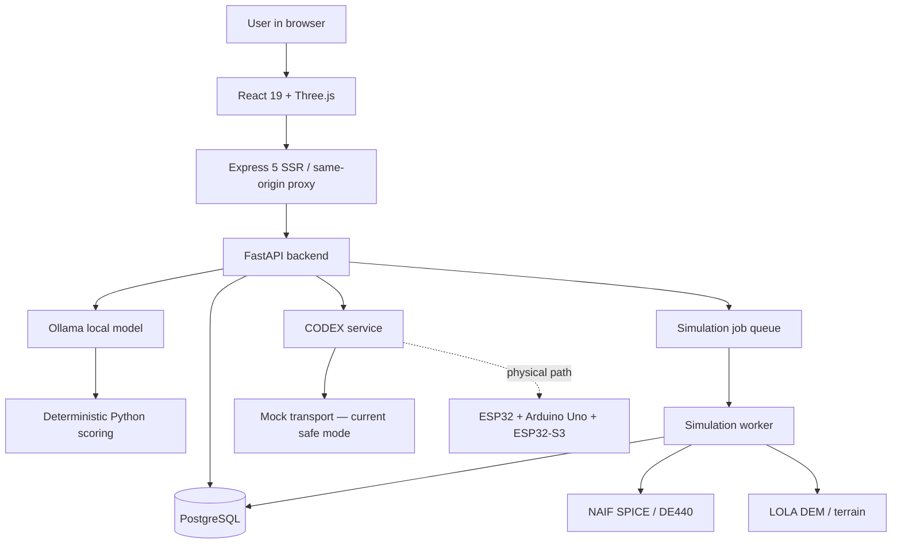
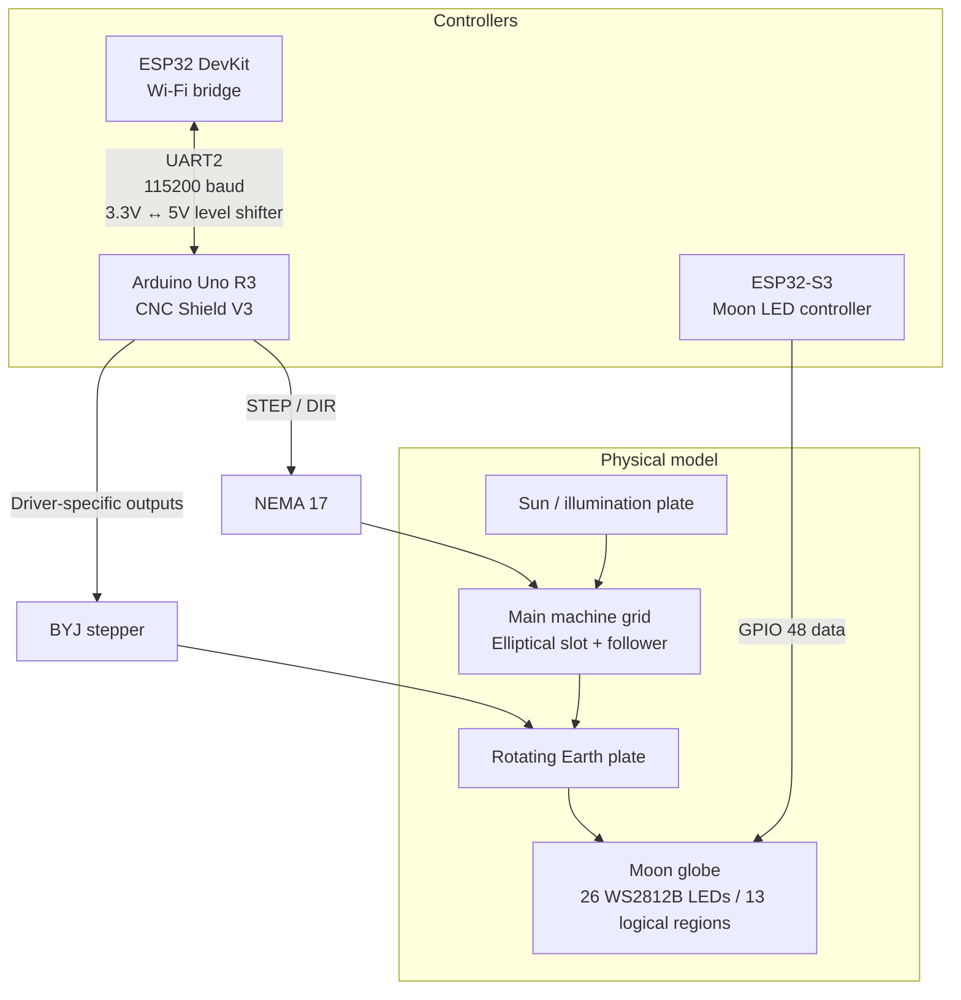
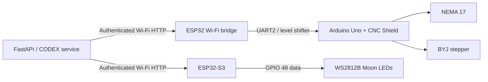

<div align="center">
  

  <h1>CLPS Luna Browser</h1>
  <p><strong>Explore lunar landing sites. Compare mission conditions. Simulate the Sun–Earth–Moon geometry. Demonstrate the result with CODEX.</strong></p>

  <h3>Presentation</h3>
  <p><a href="CLPS_Luna_Browser.pdf">📊 <strong>CLPS Luna Browser PPT</strong></a></p>

  <h3>Report and Documentation</h3>
  <p><a href="Report.pdf">📄 <strong>CLPS Luna Browser Report</strong></a></p>

  <p>
    
    
    
    
    
    
    
    
  </p>
</div>

---

## What is CLPS Luna Browser?

CLPS Luna Browser is a lunar landing-site research and visualisation platform. It brings site information, scientific conditions, comparison tools, a local AI assistant, and a physical demonstration concept into one application.

A user can:

- Explore marked lunar locations on an interactive 3D Moon.
- Read each site's overview, history, advantages, limitations, statistics, and research sources.
- Compare two sites against a stated mission purpose.
- Ask the local AI assistant to translate a mission request into comparison criteria.
- Run a time-based simulation of Sun and Earth visibility from a selected lunar site.
- View the CODEX hardware status and, when physically verified, use the model as a demonstration of the selected result.

> **Project boundary:** This is a research and demonstration tool. It is not NASA-certified, NASA-endorsed, flight-qualified, or a replacement for mission-level engineering review.

## How the system fits together



**The important separation:** Ollama helps interpret a user's request. Python retrieves the stored evidence and performs the numerical comparison. SPICE and LOLA support the scientific simulation. The browser displays results; it does not invent the scientific positions.

## Hardware: three physical stages

The physical demonstrator is arranged as three connected assemblies. The names below follow the team's mechanical description.

### 1. Sun / illumination plate

- Represents the Sun in the demonstration.
- Holds the fixed light source used to illuminate the Earth–Moon model (the team previously described a phone-controlled bulb).
- Acts as the visual reference for the orbital mechanism.
- The lamp uses its own controller; no MCU pin connection is specified in the firmware references.
- It is described here as a **light-source plate**, not a photovoltaic solar panel.

### 2. Main machine grid — the slotted drive base

This is the mechanical and electrical centre of the model.

- The machined elliptical groove and follower/slit guide the main arm along the intended path.
- The **NEMA 17** drives the main orbital arm through the stepper driver on the CNC Shield.
- The **BYJ stepper** drives the secondary Earth-plate movement through the driver configuration selected for the actual BYJ motor variant.
- The **Arduino Uno R3 + CNC Shield V3** controls the motors and safety inputs.
- The ordinary **ESP32 DevKit** provides Wi-Fi communication and passes motion commands to the Uno over UART.
- The main battery pack and power distribution are mounted on this base, with separate regulated rails for motor power and logic power.

### 3. Rotating Earth plate and Moon globe

- The Earth model is mounted on the rotating Earth plate.
- The Moon globe is mounted on its secondary support and represents the selected lunar position.
- The Moon globe contains **26 WS2812B addressable LEDs**, controlled by the **ESP32-S3**.
- The team's physical layout also places a local battery pack inside the Moon assembly; its exact pack voltage and regulator must be checked against the LED and controller supply requirements.
- The software divides the lunar surface into **13 logical regions**. The backend maps a selected site's latitude and longitude to a region and then to the configured LED pixels.
- The current firmware reference reports battery-voltage telemetry as unavailable (`null`); do not display a live battery percentage until a real voltage-sense circuit is installed and calibrated.
- An additional **HC module** has been mentioned in the team's physical description, but its exact model, function, voltage, and pinout are not identified in the supplied firmware references. Confirm its label and datasheet before wiring it; do not assume it is an HC-05 or HC-SR04.

### Hardware control layout



### Wiring reference

The pin assignments below are the firmware's documented assignments. They are **not proof that the physical wiring has been bench-tested**.

| Connection | Controller pins / interface | Notes |
|---|---|---|
| ESP32 bridge → Uno | ESP32 UART2 TX **GPIO 17** → level shifter → Uno RX **D0**; Uno TX **D1** → level shifter → ESP32 UART2 RX **GPIO 16** | Cross TX to RX; **115200 baud**; use a bidirectional 3.3V↔5V logic-level shifter; connect signal grounds. D0/D1 are also the Uno USB serial pins, so isolate the bridge during USB upload/debug when required. |
| NEMA 17 → CNC Shield | **STEP D2**, **DIR D5**, **ENABLE D8** (active LOW) | Uses a compatible step/dir driver carrier such as the configured A4988/DRV8825. Set the driver's current limit for the exact motor before operation. |
| BYJ → Uno | **Option A:** ULN2003 four-wire control on **D10–D13**. **Option B:** bipolar step/dir **STEP D4 / DIR D7** | These are alternative firmware configurations, not simultaneous wiring. A common 28BYJ-48 is a 5-wire unipolar motor and needs the ULN2003 path unless it has been correctly converted. Confirm the exact motor and compile-time setting first. |
| Emergency stop | Uno **D3 / INT1**, falling edge, `INPUT_PULLUP` | Firmware input only. Use a properly wired physical emergency-stop switch that can remove motor-driver power; do not rely on software alone. |
| Limit switch | Uno **D9** | Confirm the normally-open/normally-closed wiring and travel direction during bench setup. |
| ESP32-S3 → Moon LEDs | **GPIO 48 → WS2812B DIN** | Firmware documents 26 LEDs, GRB order, 800 kHz. Use a regulated external 5V LED supply and common ground with the S3. |
| Moon LED power | Dedicated regulated **5V** rail to LED `+5V` and GND | Never power the LED strip from an ESP32 GPIO. For a separate LED supply, join grounds. A 300–500Ω series data resistor and 500–1000µF supply capacitor are recommended by Adafruit; confirm whether the strip/board already includes them. |

**Power rule:** the main battery pack must feed correctly rated motor and regulated logic rails. Do not power motor coils from Arduino/ESP32 pins. The Moon LED supply must provide regulated 5V; if the Moon has its own battery, that battery needs an appropriate 5V regulator for the LEDs and a suitable 3.3V supply for the ESP32-S3. The project references do not specify the final battery chemistry, pack voltage, regulator part numbers, or fuse ratings—measure and select those from the actual hardware datasheets before connection.

**Driver rule:** the NEMA 17 and BYJ are not interchangeable electrical loads. Never connect an unmodified 5-wire unipolar BYJ directly to a bipolar A4988/DRV8825 output. Set the stepper driver's current limit with the correct motor data and a meter before connecting the mechanism.

### How commands reach the hardware



The bridge and the Moon LED controller are separate network devices. The bridge forwards motion commands to the Uno over UART; the ESP32-S3 handles the Moon LEDs. The firmware references document HTTP on port 80 for the ESP32 devices and UART2 at 115200 baud for the bridge-to-Uno link. Physical HTTP transport remains disabled until the outstanding signing/authentication issues and bench checks are resolved.

## Software stack — what is used where

| Technology / library | Where it is used | What it does |
|---|---|---|
| **Python 3.12** | `backend/` | Main backend and scientific-computing language. |
| **FastAPI + Uvicorn** | `backend/app/` | HTTP API, validation flow, and local API server. |
| **Pydantic v2** | `backend/app/schemas/` | Validates API input and output shapes; supplies the OpenAPI contract. |
| **SQLAlchemy 2 + psycopg 3** | `backend/app/models/`, `backend/app/db/` | Maps Python models to PostgreSQL and manages database sessions. |
| **Alembic** | `backend/alembic/` | Versioned database schema changes. |
| **PostgreSQL 18** | Application database | Stores sites, source records, metrics, comparisons, simulations, users, imports, and CODEX configuration/events. |
| **SpiceyPy / NAIF SPICE** | `backend/app/integrations/spice/` | Reads DE440 ephemeris and lunar frame kernels to calculate time-dependent Sun/Earth geometry. |
| **NumPy** | Scientific services | Vector and numerical calculations. |
| **Rasterio / GDAL** | `backend/app/integrations/terrain/` | Reads NASA LOLA elevation GeoTIFFs and terrain windows. |
| **PyProj** | Terrain integration | Converts between declared map projections and coordinate systems. |
| **Shapely** | Geometry services | Handles geometric operations used in spatial processing. |
| **OpenPyXL, CSV, JSON** | Import services | Reads supported research/data import files. |
| **Pillow** | Media service | Validates, resizes, and re-encodes uploaded images as WebP. |
| **pwdlib[argon2]** | Authentication | Password hashing for administrator accounts. |
| **httpx** | Integration clients | HTTP communication with local services such as Ollama and supported integrations. |
| **React 19 + TypeScript 5.8** | `frontend/src/` | User interface and typed application logic. |
| **React Router 7** | Frontend routes | Page navigation. |
| **TanStack Query 5** | Frontend API layer | Fetching, caching, and refreshing backend data. |
| **Three.js 0.175** | `frontend/src/three/` | 3D Moon, site markers, and Sun–Earth–Moon visualisation. |
| **React Three Fiber 9 + Drei 10** | 3D React components | Connects Three.js scenes and controls to React components. |
| **Vite 7** | `frontend/` | Frontend development server and client/SSR build tool. |
| **Express 5** | `frontend/server/` | Server-side rendering, same-origin API/storage proxy, security headers, and SEO routes. |
| **Ollama + configured local model** | `backend/app/integrations/ollama/` | Local natural-language intent extraction for AI Assist. The configured model is read from project settings (documented default: `gemma4:e4b`). |
| **AccelStepper** | Arduino Uno firmware | Stepper-motor motion control. |
| **ArduinoJson** | ESP32 firmware | Reads and writes device command/status JSON. |
| **Adafruit_NeoPixel** | ESP32-S3 firmware | Controls the WS2812B Moon LEDs. |
| **mbedTLS** | ESP32 firmware | HMAC-SHA256 command authentication. |
| **AVR watchdog (`<avr/wdt.h>`)** | Uno firmware | Resets the Uno if the main loop stops responding. |
| **pytest / Ruff / Mypy / Vitest / Playwright** | Test and quality folders | Backend tests, code checks, frontend tests, and browser end-to-end tests. |

> **Dependency note:** the supplied project reference explicitly says SciPy is not part of the backend dependency set. Do not add it just because the project performs scientific calculations; the documented implementation uses NumPy and its own numerical routines.

## Scientific data and calculations

- **NAIF SPICE / JPL DE440:** time-dependent celestial positions and lunar reference-frame orientation.
- **NASA GSFC PGDA LOLA DEM:** lunar elevation grids used to estimate terrain horizons where suitable coverage is available.
- **Lunar geometry:** the backend converts site coordinates to local geometry, then calculates Sun azimuth/elevation and Earth geometric visibility.
- **Terrain check:** the horizon model tests whether local terrain blocks the line of sight.
- **Event windows:** the simulation identifies illumination and Earth-visibility intervals over the requested time span.

**Important limits:** DEM coverage is not available at the same quality for every candidate site. Some results are explicitly `geometric_only` when terrain data is missing. Earth geometric visibility is not a radio-link budget, and sunlight visibility is not a guaranteed solar-panel power estimate.

## AI and comparison

The local model does not make the final scientific decision.

1. The user describes a mission need.
2. Ollama extracts structured criteria from the prompt.
3. FastAPI validates that output and retrieves site data from PostgreSQL.
4. The Python comparison service applies the selected profile and calculates the ranking.
5. The UI shows the result with supporting values and data-quality context.

If Ollama is unavailable or returns invalid output, the backend has a rule-based fallback. The AI does not directly write to the database or send motor commands.

## Repository layout

```text
.
├── backend/
│   ├── app/api/              # FastAPI routes
│   ├── app/core/             # Configuration, security, dependencies
│   ├── app/models/           # SQLAlchemy database models
│   ├── app/schemas/          # Pydantic request/response models
│   ├── app/services/         # Catalogue, comparison, simulation, CODEX logic
│   ├── app/integrations/     # SPICE, terrain, Ollama, CODEX protocol clients
│   ├── app/worker/           # Background simulation worker
│   └── tests/                # Backend tests
├── frontend/
│   ├── src/pages/            # Browser, site, compare, AI, simulation, CODEX pages
│   ├── src/admin/            # Admin Portal
│   ├── src/api/              # Typed API client and generated API types
│   ├── src/three/            # Three.js scenes and coordinate conversion
│   ├── server/               # Express 5 SSR server and SEO routes
│   └── tests/                # Vitest and Playwright tests
├── firmware/
│   ├── esp32-wifi-bridge/    # Wi-Fi / HTTP / UART bridge
│   ├── arduino-uno-motion/   # NEMA 17 and BYJ motion firmware
│   └── esp32-s3-moon-led/    # 26-pixel Moon LED firmware
├── data/                     # SPICE/DEM manifests and controlled data assets
├── docs/                     # Specifications, phase reports, tracking
├── run_clps.sh               # One-command macOS local launcher
└── README.md
```

## Run locally

The project includes a macOS Bash launcher that checks and starts the local services.

```bash
# From the repository root
./run_clps.sh check
./run_clps.sh start
./run_clps.sh status
```

Open the application:

**http://localhost:3000**

Stop the services started by the launcher:

```bash
./run_clps.sh stop
```

### Services started or checked

- PostgreSQL — application database.
- Ollama — optional local AI service; the app can fall back when it is unavailable.
- FastAPI — backend API (documented default port `8000`).
- Simulation worker — processes background simulation jobs.
- Express SSR — browser-facing application (documented default port `3000`).

The launcher checks the project's configured environment. Do not copy secrets into Git; use the local ignored `.env` and firmware configuration files.

## Current implementation status

| Area | Status |
|---|---|
| Public browser, site pages, comparison, and AI Assist | Implemented in software |
| SPICE / LOLA scientific simulation pipeline | Implemented in software; terrain coverage varies by site |
| Admin Portal and database management | Implemented in software |
| CODEX API, command validation, and mock transport | Implemented and software-tested |
| Physical motor calibration and mechanical travel | **Pending physical measurement** |
| Physical BYJ driver selection and wiring verification | **Pending hardware confirmation** |
| Physical 13-region / 26-pixel LED mapping | **Pending bench verification** |
| Real ESP32 ↔ Uno ↔ ESP32-S3 hardware run | **Not bench-verified** |

The firmware contains intentional compile-time safety guards until the actual BYJ driver type and LED topology are confirmed. Keep CODEX in mock/non-actuating mode until the hardware team completes the wiring inspection, fixes the outstanding firmware/backend command-signing integration issues, measures the mechanism, and verifies the emergency-stop circuit.

## Hardware safety checklist

- [ ] Identify the exact NEMA 17 model and coil pairs.
- [ ] Identify the exact BYJ model and select the correct ULN2003 or bipolar driver path.
- [ ] Verify the installed CNC Shield and driver carrier models.
- [ ] Set driver current limits from motor/driver specifications before connecting motors.
- [ ] Install and test the bidirectional 3.3V↔5V UART level shifter.
- [ ] Verify common ground and separate regulated power rails.
- [ ] Verify the physical E-STOP power-disconnect path and limit switch.
- [ ] Identify the exact HC module and verify its datasheet/pinout.
- [ ] Confirm the 26-pixel strip wiring, 13-region pixel assignments, and external 5V supply.
- [ ] Measure gear ratio, backlash, zero position, and travel limits.
- [ ] Run one motor at a time with the mechanism unloaded before coordinated movement.

**Never power motor coils from MCU GPIO pins. Never connect a 5V UART output directly to an ESP32 input. Never connect an unmodified 5-wire unipolar BYJ motor to a bipolar stepper driver.**

## References

- [NASA Commercial Lunar Payload Services (CLPS)](https://www.nasa.gov/commercial-lunar-payload-services/)
- [NASA GSFC Planetary Geodesy Data Archive — LOLA products](https://pgda.gsfc.nasa.gov/products/78)
- [NASA GSFC — South Pole LOLA DEM mosaic](https://pgda.gsfc.nasa.gov/products/81)
- [NAIF — Lunar SPICE data](https://naif.jpl.nasa.gov/naif/data_lunar.html)
- [GitHub Docs — About repository README files](https://docs.github.com/en/repositories/managing-your-repositorys-settings-and-features/customizing-your-repository/about-readmes)
- [GitHub Docs — Mermaid diagrams in Markdown](https://docs.github.com/en/get-started/writing-on-github/working-with-advanced-formatting/creating-diagrams)
- [Adafruit — NeoPixel wiring and power best practices](https://learn.adafruit.com/adafruit-neopixel-uberguide/best-practices/)
- [Pololu — A4988 driver current-limit guidance](https://www.pololu.com/product/1182/faqs)

---

<div align="center">
  <sub>CLPS Luna Browser · Built for lunar site research, scientific visualisation, and a safe physical demonstration.</sub>
</div>
