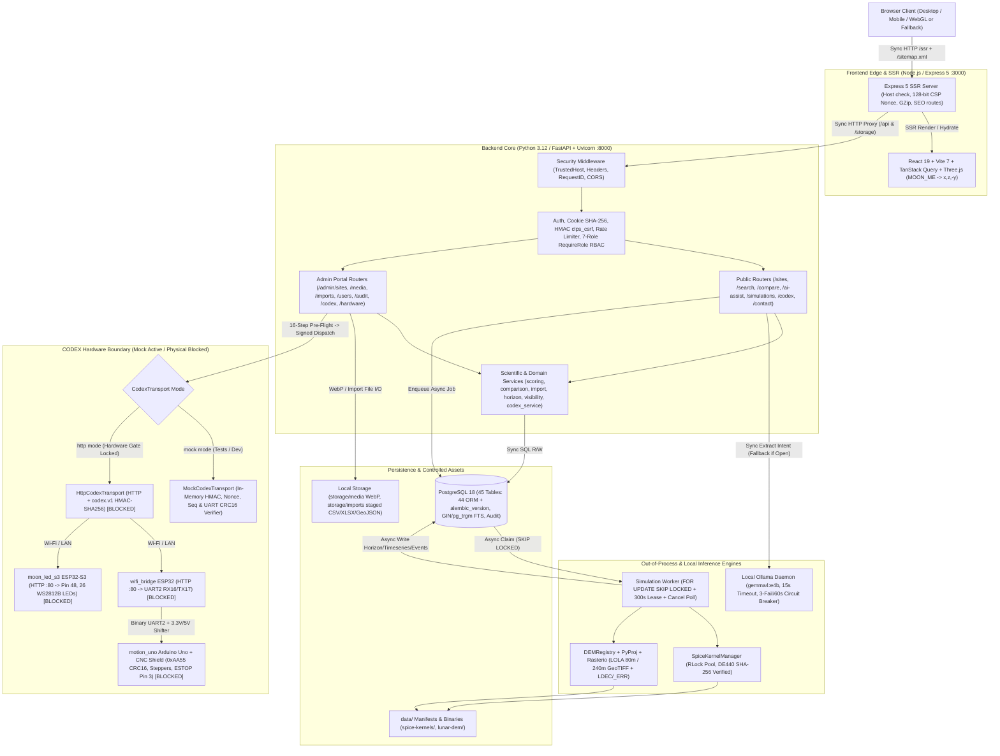

# CLPS Luna Browser — Complete Technical Master Handbook

> **Project:** CLPS Luna Browser (NASA Space Apps Challenge)
> **Repository Root:** `/Users/siddharthwaikar/Personal/CodexBase/NASA Space App Challenge/CLPS Lunar Module`
> **Documentation Mode:** Independent Read-Only Reverse Engineering (Zero Application Source Mutations)
> **Evidence Tagging Legend:**
> - `[VERIFIED IN SOURCE]` — Directly confirmed in source code, schema migrations, manifests, or firmware.
> - `[VERIFIED BY TEST]` — Directly confirmed by live read-only test/lint/typecheck/audit execution in this session.
> - `[DOCUMENTED, NOT INDEPENDENTLY VERIFIED]` — Recorded in [`PHASE_8_FINAL_VERIFICATION_REPORT.md`](file:///Users/siddharthwaikar/Personal/CodexBase/NASA%20Space%20App%20Challenge/CLPS%20Lunar%20Module/docs/project_tracking/PHASE_8_FINAL_VERIFICATION_REPORT.md) / [`TEST_EVIDENCE_TRACKER.md`](file:///Users/siddharthwaikar/Personal/CodexBase/NASA%20Space%20App%20Challenge/CLPS%20Lunar%20Module/docs/project_tracking/TEST_EVIDENCE_TRACKER.md) (e.g., Playwright live E2E & backup/restore drill).
> - `[BLOCKED BY HARDWARE]` — Physical hardware bench wiring, calibration, and `arduino-cli` compilation remain blocked (`RSK-HW-01..03`).

---

## Companion Guide Index (The Complete 7-Document Suite)

| Handbook Document | Best For | Primary Scope Covered |
|---|---|---|
| **Master Synthesis (This File)** | Full architectural mastery & tech trade-offs | Parts I–XI synthesis, architecture diagram, stack choices, operations |
| [`DATABASE_MASTER_REFERENCE.md`](file:///Users/siddharthwaikar/Personal/CodexBase/NASA%20Space%20App%20Challenge/CLPS%20Lunar%20Module/docs/team_handbook/DATABASE_MASTER_REFERENCE.md) | Database Architects & Backend Engineers | All 45 PostgreSQL tables, 3 Mermaid ERDs, constraints, 7 migrations, concurrency locks |
| [`API_MASTER_REFERENCE.md`](file:///Users/siddharthwaikar/Personal/CodexBase/NASA%20Space%20App%20Challenge/CLPS%20Lunar%20Module/docs/team_handbook/API_MASTER_REFERENCE.md) | Backend, Frontend & Security Reviewers | All 98 FastAPI operations, Express 5 SSR/SEO/proxy routes, CSRF/CSP/RBAC matrix |
| [`SCIENTIFIC_AND_HARDWARE_REFERENCE.md`](file:///Users/siddharthwaikar/Personal/CodexBase/NASA%20Space%20App%20Challenge/CLPS%20Lunar%20Module/docs/team_handbook/SCIENTIFIC_AND_HARDWARE_REFERENCE.md) | Sci-Comp & Embedded Engineers | SPICE `DE440` kernels, `spkcpo` ENU, LOLA DEM raycast, finite Sun/bisection, CODEX kinematics, LEDs, firmware & 3 static parity issues |
| [`SOURCE_CODE_MAP.md`](file:///Users/siddharthwaikar/Personal/CodexBase/NASA%20Space%20App%20Challenge/CLPS%20Lunar%20Module/docs/team_handbook/SOURCE_CODE_MAP.md) | Anyone locating or onboarding to files | Complete file inventory (`backend/`, `frontend/`, `firmware/`, `data/`, `docs/`) & dependency graph |
| [`JUDGES_PITCH_AND_TECHNICAL_QA.md`](file:///Users/siddharthwaikar/Personal/CodexBase/NASA%20Space%20App%20Challenge/CLPS%20Lunar%20Module/docs/team_handbook/JUDGES_PITCH_AND_TECHNICAL_QA.md) | Demo Presenters & Q&A Defenders | 2-min pitch, 5-min demo script, fallback playbooks, 62 jury Q&As across 12 domains |
| [`TEAM_REVISION_PLAYBOOK.md`](file:///Users/siddharthwaikar/Personal/CodexBase/NASA%20Space%20App%20Challenge/CLPS%20Lunar%20Module/docs/team_handbook/TEAM_REVISION_PLAYBOOK.md) | Whole Team before Judging | `15-min` / `1-hr` / specialist revision tracks, ownership matrix, readiness checks, glossary |

---

## Part I — Project Overview & First Principles

### 1.1 What Is CLPS and What Problem Does CLPS Luna Browser Solve?
- **CLPS (Commercial Lunar Payload Services):** NASA's Artemis-era commercial acquisition programme contracting private aerospace landers to deliver science instruments and technology demonstrations to diverse lunar destinations.
- **Why Landing-Site Selection Is Hard:** Near high lunar latitudes and the South Pole (`~80°S–90°S`), the Sun hugs the horizon (`±1.54°` axial obliquity + lunar libration). A nearby crater rim can plunge a site into days of thermal darkness (`~40 K` in PSRs vs sunlight survival), while blocking Direct-to-Earth (DTE) X/S-band radio links. Engineering teams cannot evaluate power, Earth line-of-sight, regolith slope, and mission heritage using static imagery or flat-plane shortcuts.
- **Why Multi-Layer Instead of a Static Site:** Computing 3D planetary ephemerides (`JPL DE440`), slicing `189+ MB` LOLA GeoTIFF DEMs (`360 × 1,400` curved-Moon terrain rays), running asynchronous root-finding simulations, orchestrating local AI extraction safely, maintaining relational provenance (`site_metrics -> data_sources`), and authenticating multi-controller hardware requires a true full-stack architecture: **Express 5 SSR + React 19 / Three.js + FastAPI + PostgreSQL 18 + Out-of-Process Worker + Ollama + CODEX Transport**.

### 1.2 Three Perspectives on Any User Action

| Perspective | What Happens When Exploring & Simulating *Mons Mouton* |
|---|---|
| **User Perspective** | Searches `"Mons Mouton"` in Search Drawer -> rotates textured 2K 3D Moon globe (`/browser`) -> reads sourced facts & pros/cons (`/sites/mons-mouton`) -> compares vs *Pragyan (Chandrayaan-3)* (`/compare`) -> asks AI for high-solar flat polar sites (`/ai-assist`) -> launches a 7-day solar/Earth simulation with animated 3D Orrery & downloadable CSV/JSON (`/simulation`) -> inspects the CODEX physical twin status (`/codex`). |
| **Technical Perspective** | Browser hits Express 5 SSR (`:3000`) injecting per-request 128-bit CSP nonce -> proxies `/api/v1/*` to FastAPI (`:8000`) -> `ILIKE` (`pg_trgm` GIN) + `plainto_tsquery` query PostgreSQL -> `simulation_worker.py` claims queued job atomically via `FOR UPDATE SKIP LOCKED` -> saves cached `terrain_horizon_profiles`, `simulation_samples`, `simulation_metrics`, & `simulation_event_windows` -> TanStack Query hydrates interactive charts & R3F Three.js scene. |
| **Scientific Perspective** | `SpiceKernelManager` checks SHA-256 on 6 NAIF DE440 kernels -> `DEMRegistry` loads `LDEM_80S_80MPP_ADJ.TIF` (`80 m/px`) + `LDEC` shot count + `_ERR` `1-sigma` uncertainty -> `horizon.py` traces 3D spherical-curved rays to `100 km` -> `ephemeris.py` calls pole-safe `spkcpo(..., abcorr="LT+S")` in `MOON_ME` -> `visibility.py` evaluates finite solar disk (`695,700 km`) & Earth (`6,371 km`) circular segments and bisects transitions (`<= 1.0 s`). |

### 1.3 Genuine Differentiators vs. Strict Non-Claims
- **Genuine Differentiators `[VERIFIED IN SOURCE]`:**
  1. **Polar Singularity Elimination:** Avoids `CSPICE azlcpo` crash (`SPICE(POINTONZAXIS)`) at ±90° poles via `spkcpo` + analytical ENU basis.
  2. **Honest Provenance & Missing-Data Disclosure:** Never invents hills outside South Pole DEM coverage (`geometric_only` explicit mode), warns when LOLA `LDEC = 0` exceeds 50%, carries source citations per metric, and marks CODEX real hardware transparently as **`Blocked`**.
  3. **Hallucination-Proof Local AI Separation:** `Ollama gemma4:e4b` is strictly boxed into extracting schema-validated JSON parameters/weights; pure Python (`scoring.py`) computes scores and builds rationales solely from verified DB numbers.
  4. **Defense-in-Depth Security & Safety Locks:** `Argon2id` + SHA-256 `HttpOnly` sessions + HMAC `clps_csrf` + per-request 128-bit CSP nonces + 7-role backend RBAC + `codex.v1` HMAC + `<HBBIH>` CRC16 UART + compile-time `#error "SAFETY BLOCK:"` MCU guards.
- **Explicit Non-Claims:** CLPS Luna Browser is **NOT** NASA-certified, NASA-endorsed, or flight-qualified software, and physical CODEX actuators (`Arduino Uno` + `ESP32` + `ESP32-S3`) are **NOT** bench-verified (`[BLOCKED BY HARDWARE]`).

---

## Part II — Complete System Architecture `[VERIFIED IN SOURCE]`

---

## Part III — Complete Technology Stack & Selection Defense `[VERIFIED IN SOURCE]`

### 3.1 Inventory of Verified Technologies

| Layer | Technology | Where Used | Why Chosen & Trade-Offs |
|---|---|---|---|
| **Backend API** | Python 3.12, FastAPI `>=0.115`, Uvicorn, Pydantic v2 | `backend/app/` | Typed OpenAPI 3.1 contract export (`schema.ts`), async/sync ecosystem parity with C scientific libs. Limitation: GIL for pure-Python loops (mitigated via NumPy & external worker). |
| **Database & Migrations** | PostgreSQL 18, SQLAlchemy `>=2.0.36`, psycopg v3 `>=3.2`, Alembic `>=1.14` | `backend/app/models/`, `alembic/` | Strict ACID FK provenance, `FOR UPDATE SKIP LOCKED`, `pg_trgm` + `tsvector` GIN search, 7 linear migrations. |
| **Scientific Stack** | `spiceypy >=8.3`, `numpy >=2.5.4`, `rasterio >=1.5.2`, `pyproj >=3.8`, `shapely >=2.2` | `integrations/{spice,terrain}/`, `services/{horizon,visibility,geometry}` | Official NAIF CSPICE bindings, C-backed GDAL window slicing, CRS-aware transforms, computational geometry. **Note: `SciPy` is NOT present** (`pyproject.toml`)—avoids extra binary bloat because NumPy + pure-Python bisection cover all math cleanly. |
| **Ingest & Media** | `openpyxl >=3.1.5`, `csv`, `json`, `pillow >=11.0`, `pwdlib[argon2]`, `httpx` | `services/{import,media}_service.py`, `core/security.py` | Safe XLSX parsing, raster sanitization + WebP re-encoding, memory-hard Argon2id hashing, sync/async HTTP client. |
| **Frontend & 3D** | React `19.2`, TypeScript `5.8`, React Router `7.13`, TanStack Query `5.90`, `three 0.175`, `@react-three/fiber 9.1`, `@react-three/drei 10.7`, Vite `7.3` | `frontend/src/` | Declarative interactive 3D lunar scenes, strict compiler checking against `openapi-typescript` DTOs, split chunks (`three-vendor`). Limitation: WebGL hardware dependency (mitigated via `MoonFallbackView`). |
| **SSR / Edge Server** | Node.js + **Express `5.1`** (`ssr-server.mjs`, `seo-routes.mjs`) | `frontend/server/` | Express 5 native async error handling, dynamic SEO `/sitemap.xml`, streaming multi-`Set-Cookie` `/api` proxy, per-request 128-bit CSP nonces, semantic 404s. |
| **Local AI** | **Ollama** (`gemma4:e4b` default) + circuit breaker (`ollama/client.py`) | `services/ai_assist_service.py` | Zero external API keys/cloud egress, constrained JSON output, automatic rule-based fallback. Limitation: requires local GPU/RAM for fast LLM inference. |
| **Hardware Stack** | **ESP32** (`wifi_bridge`), **Arduino Uno R3 + CNC Shield v3** (`motion_uno`), **ESP32-S3** (`moon_led_s3`), `AccelStepper`, `Adafruit_NeoPixel`, `ArduinoJson`, `mbedtls`, `<avr/wdt.h>` | `firmware/` + `backend/app/integrations/codex/` | Matches real bench driver electronics (`5V` CNC Shield + `3.3V` Wi-Fi + `26` WS2812B LEDs). Hardware compilation (`arduino-cli`/`pio`) and bench tests remain **`[BLOCKED BY HARDWARE]`**. |
| **Verification Tooling** | `pytest`, `pytest-cov`, `pytest-asyncio`, `ruff`, `mypy`, `vitest`, `@testing-library/react`, `playwright`, `npm audit` | `backend/tests/`, `frontend/{src/test,tests/e2e}/` | Real PostgreSQL `clps_luna_test` DB integration suite (`115` tests), `mypy` static type checks (`84` modules), `vitest` (`22` tests), Playwright multi-viewport E2E. |

### 3.2 Engineering Selection Defense ("Why X Instead of Y?")

- **Why FastAPI instead of Flask/Django?** Automatic OpenAPI 3.1 schema generation feeds `openapi-typescript` (`8,233`-line `schema.ts`), eliminating client/server DTO drift while giving fast dependency injection (`RequireRole`, `get_db`, `rate_limiter`) without Django's monolithic ORM lock-in.
- **Why Python for scientific calculations?** Official NASA NAIF `spiceypy`, GDAL `rasterio`, `pyproj`, `shapely`, and `numpy` execute vector math and GeoTIFF I/O in compiled C under the hood while integrating seamlessly with the FastAPI/SQLAlchemy stack.
- **Why PostgreSQL instead of MongoDB?** Relational foreign-key provenance (`site_metrics -> data_sources`), multi-role RBAC joins, transactional dataset import rollbacks, full-text GIN + `pg_trgm` trigram search, and `FOR UPDATE SKIP LOCKED` atomic worker queues.
- **Why Express 5 SSR instead of static Vite / Nginx?** Static hosting cannot generate unique per-request 128-bit CSP nonces, cannot hydrate SEO metadata/Schema.org JSON-LD cleanly on `/sites/:slug`, causes CORS/SameSite cookie complexity without a same-origin proxy, and returns SPA soft-`200` on missing URLs.
- **Why Ollama (`gemma4:e4b`) instead of a cloud LLM?** Offline hackathon resilience, zero API cost/keys, data privacy, and safe bounding behind a strict `EXTRACTION_JSON_SCHEMA` + `3`-fail/`60s` circuit breaker + deterministic keyword fallback.
- **Why SPICE + LOLA DEM instead of simple Kepler approximations / flat maps?** At polar latitudes, grazing Sun angles (`~0.27°` solar radius) and `~2.88 km` lunar curvature drop across `100 km` rays decide survival vs freeze-out; approximate trigonometry produces physically wrong results.
- **Why out-of-process worker instead of FastAPI `BackgroundTasks`?** Protects API responsiveness, survives Uvicorn restarts, recovers crashed leases after `300 s`, and isolates non-reentrant `CSPICE` global kernel pool locks cleanly.
- **Why 3 controllers + `MockCodexTransport` instead of 1 MCU or hardcoded stubs?** CNC Shield v3 (`5V` AVR + hardware `INT1` pin 3 E-STOP + `WDTO_2S`) pairs naturally with Uno, while `ESP32` handles Wi-Fi/mbedTLS HMAC and `ESP32-S3` handles `26`-pixel `NEO_GRB` timing independently; `MockCodexTransport` runs genuine HMAC, nonce, sequence, and `<HBBIH>` CRC16 checks in memory until bench hardware is wired.

---

## Part IV — Security, Auth, CSRF, CSP & RBAC Architecture `[VERIFIED IN SOURCE]`

*Deep Reference:* [`API_MASTER_REFERENCE.md`](file:///Users/siddharthwaikar/Personal/CodexBase/NASA%20Space%20App%20Challenge/CLPS%20Lunar%20Module/docs/team_handbook/API_MASTER_REFERENCE.md)

1. **Credential Storage:** `admins.password_hash` uses **Argon2id** (`pwdlib`); `admin_sessions.token_hash` stores **SHA-256** of opaque `secrets.token_urlsafe` cookies (`clps_session`)—zero plaintext tokens in DB or browser `localStorage`.
2. **Account Lockout & Throttling:** `AUTH_LOCKOUT_THRESHOLD = 5` failures locks account for `15 min`; per-IP sliding-window rate limiters guard `/auth/login`, `/contact`, `/ai-assist`, `/simulations`, and `/codex`. Session `last_active_at` writes throttle to `>= 60 s` intervals (`auth_dependency.py`).
3. **CSRF & Origin Protection (`core/csrf.py`):** Unsafe methods (`POST/PUT/PATCH/DELETE`) carrying cookie auth require matching `X-CSRF-Token` verified via constant-time `hmac.compare_digest` against HMAC-bound `clps_csrf` cookie + allowed Origin check.
4. **7-Role Backend-Enforced RBAC (`007` Migration + `RequireRole`):** `super_admin` (full override + last-super-admin self-protection in `users.py`), `system_admin`, `site_editor`, `research_admin`, `hardware_admin`, `hardware_operator`, `viewer`.
5. **Transport & Browser Hardening:** Express 5 Host-header allow-list, per-request 128-bit `script-src 'self' 'nonce-...'` CSP on HTML, `default-src 'none'; frame-ancestors 'none'` on FastAPI JSON, `X-Frame-Options: DENY`, `X-Content-Type-Options: nosniff`, `Cache-Control: no-store` on `/admin*`, escaped JSON-LD (`HeadTags.tsx`), sanitized error envelopes (`middleware.py`), and secret-redacted `audit_logs`.

---

## Part V — Database & Scientific Computation Engine `[VERIFIED IN SOURCE]`

*Deep References:* [`DATABASE_MASTER_REFERENCE.md`](file:///Users/siddharthwaikar/Personal/CodexBase/NASA%20Space%20App%20Challenge/CLPS%20Lunar%20Module/docs/team_handbook/DATABASE_MASTER_REFERENCE.md) · [`SCIENTIFIC_AND_HARDWARE_REFERENCE.md`](file:///Users/siddharthwaikar/Personal/CodexBase/NASA%20Space%20App%20Challenge/CLPS%20Lunar%20Module/docs/team_handbook/SCIENTIFIC_AND_HARDWARE_REFERENCE.md)

- **45 PostgreSQL Tables:** `44` SQLAlchemy ORM models across 8 domain groups (`Catalogue`, `Metrics & Provenance`, `Comparison`, `Simulations`, `CODEX Hardware`, `Admin & RBAC`, `Operations & Audit`) + `alembic_version`, evolved cleanly through 7 sequential migrations (`356b56f822c2` -> `007_phase7_admin_and_security`).
- **Search & Query Efficiency:** English `tsvector` + weighted GIN + `pg_trgm` trigram search (`search_service.py` in `3` queries); `2`-query `selectin` hydration for `SiteInfoPage`; PostgreSQL `TEXT` uncapped sections verified up to `13,500` words (`test_database_contract.py`).
- **Simulation Worker Cycle:** Queue insert -> out-of-process worker claim (`FOR UPDATE SKIP LOCKED`, `300 s` lease) -> SPICE `DE440` checksummed pool -> LOLA DEM window (`LDEM_80S_80MPP_ADJ.TIF` `80 m/px` + `LDEC` + `_ERR`, or `240 m/px`, or explicit `geometric_only`) -> 3D curved horizon raycast (`360 × 1,400 @ 100 km`, SHA cached in `terrain_horizon_profiles`) -> pole-safe `spkcpo` (`LT+S`) -> finite solar/Earth disk segment evaluation + `24`-iter (`<= 1.0 s`) bisection -> persistent `simulation_samples`, `simulation_metrics`, & `simulation_event_windows`.

---

## Part VI — AI Assist & Circuit Breaker Architecture `[VERIFIED IN SOURCE]`

Location: [`ai_assist_service.py`](file:///Users/siddharthwaikar/Personal/CodexBase/NASA%20Space%20App%20Challenge/CLPS%20Lunar%20Module/backend/app/services/ai_assist_service.py) · [`ollama/client.py`](file:///Users/siddharthwaikar/Personal/CodexBase/NASA%20Space%20App%20Challenge/CLPS%20Lunar%20Module/backend/app/integrations/ollama/client.py) · [`ollama/prompts.py`](file:///Users/siddharthwaikar/Personal/CodexBase/NASA%20Space%20App%20Challenge/CLPS%20Lunar%20Module/backend/app/integrations/ollama/prompts.py)

1. **Prompt Firewall:** `sanitize_user_prompt` neutralizes injection substrings (`ignore previous instructions`, `drop table`, `select ... from`, `system:`, `admin:`, `<script`).
2. **Constrained Intent Extraction:** Local Ollama (`gemma4:e4b`, `15.0 s` timeout) runs with `EXTRACTION_JSON_SCHEMA` (`format="json"`), strictly emitting JSON weights/constraints across `6` allow-listed metric keys—never SQL or site scores.
3. **Circuit Breaker & Deterministic Fallback:** After `3` consecutive Ollama errors, breaker opens for `60.0 s` (half-open trial afterward) and invokes `extract_requirements_rule_based`, returning explicit `fallback_used = True` / `model_used = "rule-based-fallback"`.
4. **Zero-Hallucination Ranking & Rationales:** Pure Python (`scoring.py`) evaluates candidates against PostgreSQL `SiteMetric` rows and generates numeric summary rationales deterministically (`RATIONALE_SYSTEM_PROMPT` in `prompts.py` is unused by design).

---

## Part VII — CODEX Hardware, Firmware & Honest Readiness Boundary

*Deep Reference:* [`SCIENTIFIC_AND_HARDWARE_REFERENCE.md §5–8`](file:///Users/siddharthwaikar/Personal/CodexBase/NASA%20Space%20App%20Challenge/CLPS%20Lunar%20Module/docs/team_handbook/SCIENTIFIC_AND_HARDWARE_REFERENCE.md)

- **Three Controllers:** `wifi_bridge` (ESP32 HTTP -> UART2 `GPIO 16/17` via **3.3V↔5V level shifter**), `motion_uno` (Arduino Uno R3 + CNC Shield v3: NEMA17 `STEP=2/DIR=5/EN=8`, BYJ, `ESTOP INT1=3`, `LIMIT=9`, `WDTO_2S`, `MAX_ALLOWED_COMMAND_STEPS=200000L`), `moon_led_s3` (ESP32-S3: `26` WS2812B LEDs on `GPIO 48`, external 5V PSU).
- **16-Step Safety Gate:** Every physical run requires `prepare` (`POST /api/v1/codex/runs/prepare`) -> explicit `confirmed=true` + unique `idempotency_key` in `POST /api/v1/codex/runs`, triggering strict live checks (`bench_verified` devices & calibrations, fresh heartbeats, UART health, travel/acceleration/rate trapezoidal bounds, exact gnomonic 13-region polygon mapping without centroid fallback, no latched E-STOP, non-default HMAC secret).
- **Physical Blockers & Static Findings `[BLOCKED BY HARDWARE]`:**
  - `arduino-uno-motion.ino:16` & `esp32-s3-moon-led.ino:17` intentionally retain active `#error "SAFETY BLOCK:"` compile guards; `arduino-cli` / `pio` are absent on host.
  - Static source review surfaced `3` HTTP-to-ESP32 parity items to resolve during Phase 5 bench bring-up: `HttpCodexTransport._post_command` appending `uart_frame_hex` after signing (`client.py:402`), unsorted `ArduinoJson` serialization in both ESP32 sketches (`esp32-wifi-bridge.ino:188`, `esp32-s3-moon-led.ino:92`), and missing HMAC call in ESP32 `handle_estop()` handlers (`esp32-wifi-bridge.ino:272`, `esp32-s3-moon-led.ino:175`). Meanwhile, `MockCodexTransport` exercises real HMAC, replay, sequence, and CRC16 validation cleanly in software.

---

## Part VIII — Frontend, SSR, SEO & 3D Visualization `[VERIFIED IN SOURCE]`

- **Routing (`AppRoutes.tsx`):** `21` exact public/admin paths plus dynamic `/sites/:siteSlug`, `/simulation/:simulationId`, `/admin/sites/:siteId`, and `/admin/codex/firmware/:versionId`; unknown routes return real HTTP `404` via Express 5 SSR.
- **3D Engine (`frontend/src/three/`):** Canonical `spiceMoonMeToThree([x,y,z], s) = [x*s, z*s, -y*s]` preserves right-handed `Y-up` orientation across textured 2K WebP Moon (`LunarMoonCanvasClient`) and SPICE Sun-Earth-Moon Orrery (`SimulationOrreryCanvasClient`), with accessible SVG fallback (`MoonFallbackView`).
- **SEO & Metadata (`seo-routes.mjs`, `HeadTags.tsx`):** Dynamic `/sitemap.xml` built from live `/api/v1/sites`, `/robots.txt` disallowing `/admin` & `/api`, `<` escaped JSON-LD Schema.org blocks, and manual Rollup chunk splitting (`three-vendor`, `react-vendor`).

---

## Part IX — Admin Portal, Comparison Engine, Imports & Split-Pane Firmware IDE `[VERIFIED IN SOURCE]`

1. **Multi-Criteria Site Comparison (`ComparePage.tsx`, `comparison_service.py`):** Evaluates two published sites under 5 seeded profiles (`solar_maximization`, `direct_earth_comm`, `volatile_prospecting`, `geological_research`, `general_exploration`) or custom weights with transparent `complete` / `partial` / `insufficient_data` reporting.
2. **Dataset Stage / Commit / Rollback (`AdminImportsPage.tsx`, `import_service.py`):** Parses CSV (`utf-8-sig`), XLSX (`openpyxl`), and GeoJSON (`FeatureCollection Point`), validates spherical coordinates & lunar proximity (`1,737.4 km`), stages rows in `dataset_imports`, commits atomically, and supports clean rollback.
3. **Admin Site, Media, Users & Audit (`AdminSiteEditorPage.tsx`, `AdminMediaPage.tsx`, `AdminUsersPage.tsx`, `AdminAuditHealthPage.tsx`):** 6-tab site editor (unlimited `TEXT` sections, pros/cons, history, metrics, media), Pillow-re-encoded WebP uploads, `super_admin` user lifecycle with last-super-admin safeguards, live subsystem probes, and secret-redacted audit search.
4. **Split-Pane Firmware IDE (`AdminFirmwareEditorPage.tsx`, `codex_template_engine.py`):** Side-by-side C++ template source/preview, in-file search, syntax highlight, unified diff between DB versions, one-click live DB variable insertion, allow-list placeholder + C-injection filter (`UNSAFE_C_FRAGMENTS`), SHA-256 snapshotting, and explicit **No Auto-Flash Safety Policy**.

---

## Part X — Verification & Evidence Ledger

| Check / Drill | Observed Result & Date (`2026-11-11`) | Evidence Classification |
|---|---|---|
| Backend Lint (`ruff check app tests`) | Passed (`All checks passed!`) | `[VERIFIED BY TEST]` |
| Backend Typecheck (`mypy app`) | Passed (`Success: no issues found in 84 source files`) | `[VERIFIED BY TEST]` |
| Backend Suite (`pytest --cov=app` vs `clps_luna_test`) | **115 passed** (`9` warnings, `91%` coverage across `7,915` stmts) | `[VERIFIED BY TEST]` |
| Frontend Typecheck (`npx tsc --noEmit`) | Passed (`0` errors) | `[VERIFIED BY TEST]` |
| Frontend Unit/Component (`npm test -- --run`) | **4 files / 22 tests passed** (`coordinates`, `seo-and-ssr`, `pages`, `admin-portal`) | `[VERIFIED BY TEST]` |
| Frontend Dependency Security (`npm audit --json`) | Passed (`0` vulnerabilities across npm graph) | `[VERIFIED BY TEST]` |
| Playwright Live E2E (`clps-e2e.spec.ts` + `admin-portal.spec.ts`) | **5 passed** (`41.8 s`, desktop/laptop/tablet/mobile, 0 console/CSP errors) | `[DOCUMENTED, NOT INDEPENDENTLY VERIFIED]` (Recorded in `PHASE_8_FINAL_VERIFICATION_REPORT.md`) |
| PostgreSQL Backup / Restore Drill (`clps_luna`) | **45 tables / 4,097 rows restored (`0` mismatches, `347,380 B`, `0.782s`)** | `[DOCUMENTED, NOT INDEPENDENTLY VERIFIED]` (Recorded in `PHASE_8_FINAL_VERIFICATION_REPORT.md`) |
| Physical CODEX Bench & MCU Flashing | Blocked (`arduino-cli`/`pio` absent, `#error` guards intact, `RSK-HW-01..03`) | `[BLOCKED BY HARDWARE]` |

---

## Part XI — Operations & Troubleshooting Runbook (`run_clps.sh`) `[VERIFIED IN SOURCE]`

- **Single-Command Orchestration ([`run_clps.sh`](file:///Users/siddharthwaikar/Personal/CodexBase/NASA%20Space%20App%20Challenge/CLPS%20Lunar%20Module/run_clps.sh)):** Supports `./run_clps.sh check`, `start`, `stop`, `status`, `--migrate`, `--prod`, and `--backend-port=<N>`, storing ephemeral lock/PID/log state in `/tmp/clps-luna-browser-<uid>/` without dirtying the repo.
- **Default Dev Credentials ([`Readme`](file:///Users/siddharthwaikar/Personal/CodexBase/NASA%20Space%20App%20Challenge/CLPS%20Lunar%20Module/Readme)):**
  - `test_super_admin` / `TestAdminPass123!` (`super_admin`)
  - `test_viewer` / `TestViewerPass123!` (`viewer`)
- **Common Operational Failure Signatures & Fixes:**
  1. **`Ollama unreachable` (`FALLBACK MODE` in launcher):** Verify `ollama serve` & `gemma4:e4b`; application continues uninterrupted in deterministic rule-based extraction mode.
  2. **`SpiceKernelError` on startup:** Run `./run_clps.sh check` to inspect `data/spice-kernels/manifest.json` presence and SHA-256 verification.
  3. **`Simulation remains queued`:** Check worker process via `./run_clps.sh status`; restart cleanly if stopped (`python -m app.worker.simulation_worker`).
  4. **`HTTP 403 CSRF missing/invalid`:** Ensure client calls `GET /api/v1/auth/csrf` cleanly or uses same-origin `:3000` SSR proxy so `clps_csrf` cookie is readable for `X-CSRF-Token`.
  5. **`CODEX execution returns 409 Conflict`:** Expected safety lock whenever `CODEX_REQUIRE_VERIFIED_BENCH=True` blocks unverified calibrations/devices (`Step 6 / 10 / 11`).
