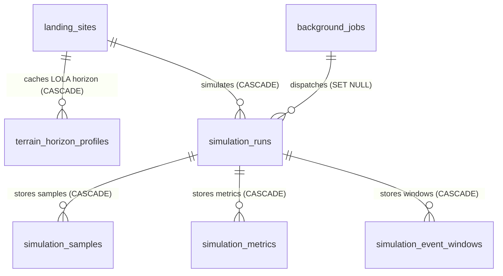
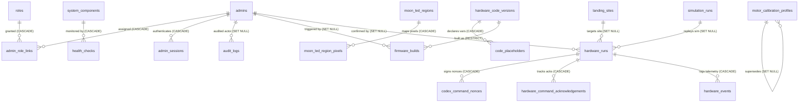
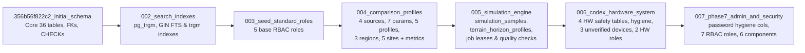

# CLPS Luna Browser — Database Master Reference

> **Purpose:** Authoritative relational schema, migration, indexing, concurrency, provenance, and disaster-recovery reference for **PostgreSQL 18 + SQLAlchemy 2.0 + Alembic** in CLPS Luna Browser.  
> **Scope & Honesty Tagging:** Every claim in this document uses explicit evidence tags:
> - `[VERIFIED IN SOURCE]` — Directly verified in SQLAlchemy ORM models, Alembic migrations, repositories, and `Base.metadata` introspection.
> - `[VERIFIED BY TEST]` — Verified by live test execution (`pytest` against `clps_luna_test` in this session).
> - `[DOCUMENTED, NOT INDEPENDENTLY VERIFIED]` — Recorded in project tracking documentation (e.g., Phase 8 live backup/restore drill against `clps_luna`) and not re-executed against the live database during this read-only audit.
> - `[INFERRED]` — Architectural implication directly derived from verified code behavior.

---

## 1. Database Architecture & Connection Topology

- **RDBMS:** PostgreSQL 18 (`pg_trgm` extension enabled; synchronous driver `psycopg` 3 via `SQLAlchemy 2.0`) `[VERIFIED IN SOURCE]`.
- **Engine Configuration ([`backend/app/db/session.py`](file:///Users/siddharthwaikar/Personal/CodexBase/NASA%20Space%20App%20Challenge/CLPS%20Lunar%20Module/backend/app/db/session.py#L11-L33)):**
  - `create_engine(settings.DATABASE_URL, pool_pre_ping=True, pool_size=5, max_overflow=10, future=True)` `[VERIFIED IN SOURCE]`.
  - `SessionLocal = sessionmaker(bind=engine, autocommit=False, autoflush=False, expire_on_commit=False)` `[VERIFIED IN SOURCE]`.
  - FastAPI request lifecycle injects one `Session` per request via `get_db()` (`yield db` with `finally: db.close()`).
  - Background worker (`app.worker.simulation_worker`) opens isolated `SessionLocal()` contexts per claimed job or progress flush `[VERIFIED IN SOURCE]`.
- **Database Isolation & Safety:**
  - Live/runtime database uses `DATABASE_URL` from `.env` (documented in Phase 8 report as `clps_luna` under least-privilege role `clps_app`) `[DOCUMENTED, NOT INDEPENDENTLY VERIFIED]`.
  - Pytest test suite ([`backend/tests/conftest.py`](file:///Users/siddharthwaikar/Personal/CodexBase/NASA%20Space%20App%20Challenge/CLPS%20Lunar%20Module/backend/tests/conftest.py)) strictly requires `TEST_DATABASE_URL` ending with `"_test"` (verified running cleanly on `clps_luna_test`: **115 passed**) `[VERIFIED BY TEST]`.

---

## 2. Table Inventory (45 Tables Across 5 Subsystems + Alembic)

`Base.metadata` declares **44 ORM tables** across 8 modules in `backend/app/models/`, plus **`alembic_version`** = **45 tables total** `[VERIFIED IN SOURCE]`.

| Subsystem | Module | Table Count | Tables |
|---|---|---|---|
| **1. Auth, RBAC, Audit & Health** | `admin.py`, `operations.py` | 7 | `admins`, `roles`, `admin_role_links`, `admin_sessions`, `audit_logs`, `system_components`, `health_checks` |
| **2. Catalogue, Provenance, Imports & Contact** | `catalogue.py`, `provenance.py`, `operations.py` | 12 | `nasa_regions`, `landing_sites`, `site_aliases`, `site_content`, `site_history`, `site_pros_cons`, `site_media`, `data_sources`, `site_source_links`, `dataset_imports`, `import_rows`, `contact_messages` |
| **3. Scientific Metrics & Comparison** | `metrics.py`, `comparison.py` | 7 | `parameter_definitions`, `site_metrics`, `metric_observations`, `comparison_profiles`, `comparison_profile_parameters`, `comparison_runs`, `comparison_results` |
| **4. Simulation Engine & Worker Queue** | `operations.py`, `simulation.py` | 6 | `background_jobs`, `terrain_horizon_profiles`, `simulation_runs`, `simulation_samples`, `simulation_metrics`, `simulation_event_windows` |
| **5. CODEX Hardware, Firmware & Safety** | `codex.py` | 12 | `hardware_devices`, `hardware_configurations`, `motor_calibration_profiles`, `moon_led_regions`, `moon_led_region_pixels`, `hardware_code_versions`, `code_placeholders`, `firmware_builds`, `hardware_runs`, `codex_command_nonces`, `hardware_command_acknowledgements`, `hardware_events` |
| **6. Schema Versioning** | Alembic | 1 | `alembic_version` |

> **Exact Count Check:** `7` (Auth/Audit/Health) + `12` (Catalogue/Provenance/Media/Imports/Contact) + `7` (Metrics/Comparison) + `6` (Jobs & Simulation Engine) + `12` (CODEX Hardware) = **`44` ORM tables** + **`1` `alembic_version`** = **`45` PostgreSQL tables** `[VERIFIED IN SOURCE]`.

---

## 3. Entity-Relationship Diagrams

### 3.1 Core Catalogue, Provenance, Media & Comparison ERD

```mermaid
erDiagram
    nasa_regions ||--o{ landing_sites : "contains (RESTRICT)"
    landing_sites ||--o{ site_aliases : "has aliases (CASCADE)"
    landing_sites ||--o{ site_content : "has sections (CASCADE)"
    landing_sites ||--o{ site_history : "has timeline (CASCADE)"
    landing_sites ||--o{ site_pros_cons : "has pros/cons (CASCADE)"
    landing_sites ||--o{ site_media : "has media (CASCADE)"
    landing_sites ||--o{ site_source_links : "cites sources (CASCADE)"
    data_sources ||--o{ site_source_links : "linked to sites (CASCADE)"
    data_sources ||--o{ dataset_imports : "sourced from (SET NULL)"
    dataset_imports ||--o{ import_rows : "stages rows (CASCADE)"
    landing_sites ||--o{ import_rows : "resolves target (SET NULL)"

    parameter_definitions ||--o{ site_metrics : "defines (RESTRICT)"
    landing_sites ||--o{ site_metrics : "measured by (CASCADE)"
    data_sources ||--o{ site_metrics : "cited by (SET NULL)"
    landing_sites ||--o{ metric_observations : "observes (CASCADE)"
    parameter_definitions ||--o{ metric_observations : "typed by (RESTRICT)"

    comparison_profiles ||--o{ comparison_profile_parameters : "weights (CASCADE)"
    parameter_definitions ||--o{ comparison_profile_parameters : "weighted in (RESTRICT)"
    comparison_profiles ||--o{ comparison_runs : "governs (SET NULL)"
    landing_sites ||--o{ comparison_runs : "compares site_a/b (CASCADE)"
    comparison_runs ||--o{ comparison_results : "outputs (CASCADE)"
    parameter_definitions ||--o{ comparison_results : "scores param (RESTRICT)"
```

### 3.2 Simulation Engine & Background Worker ERD

### 3.3 Admin RBAC, Audit & CODEX Hardware Safety ERD

---

## 4. Complete Table-by-Table Schema Reference (All 45 Tables)

> Notation: `PK` = Primary Key, `NN` = `NOT NULL`, `NULL` = Nullable, `UQ` = Unique, `FK -> table.col (ON DELETE)` = Foreign Key constraint. Column types and constraints match live `Base.metadata` introspection `[VERIFIED IN SOURCE]`.

### Subsystem 1: Auth, RBAC, Audit & System Health (`backend/app/models/admin.py`, `operations.py`)

#### 1. `admins`
| Column | Type | Null / Key | Notes |
|---|---|---|---|
| `admin_id` | `UUID` | `PK NN` | Admin identity UUID |
| `username` | `VARCHAR(100)` | `NN UQ` | Unique login name (`ix_admins_username`) |
| `password_hash` | `TEXT` | `NN` | Argon2id / bcrypt password digest |
| `display_name` | `TEXT` | `NULL` | Human-readable operator name |
| `is_active` | `BOOLEAN` | `NN` | Account enable flag (`ix_admins_is_active`) |
| `failed_login_count` | `INTEGER` | `NN` | Incremented on bad password; lockout gate |
| `locked_until` | `DATETIME(TZ)` | `NULL` | Account brute-force lockout expiry |
| `password_updated_at` | `DATETIME(TZ)` | `NULL` | Added in migration `007` |
| `password_must_rotate` | `BOOLEAN` | `NN` | Default `false`; added in migration `007` |
| `created_at` | `DATETIME(TZ)` | `NN` | Account creation timestamp |
| `last_login_at` | `DATETIME(TZ)` | `NULL` | Latest login timestamp |
- **Indexes:** `ix_admins_username(username, uq=True)`, `ix_admins_is_active(is_active, uq=False)`.

#### 2. `roles`
| Column | Type | Null / Key | Notes |
|---|---|---|---|
| `role_id` | `BIGINT` | `PK NN` | Role ID |
| `role_key` | `VARCHAR(50)` | `NN UQ` | `super_admin`, `system_admin`, `site_editor`, `research_admin`, `hardware_admin`, `hardware_operator`, `viewer` |
| `description` | `TEXT` | `NULL` | Capability summary |
- **Indexes:** `ix_roles_role_key(role_key, uq=True)`.

#### 3. `admin_role_links`
| Column | Type | Null / Key | Notes |
|---|---|---|---|
| `admin_id` | `UUID` | `PK NN` | `FK -> admins.admin_id (CASCADE)` |
| `role_id` | `BIGINT` | `PK NN` | `FK -> roles.role_id (CASCADE)` |

#### 4. `admin_sessions`
| Column | Type | Null / Key | Notes |
|---|---|---|---|
| `session_id` | `UUID` | `PK NN` | Session UUID |
| `admin_id` | `UUID` | `NN` | `FK -> admins.admin_id (CASCADE)` |
| `token_hash` | `VARCHAR(64)` | `NN UQ` | SHA-256 hex digest of `HttpOnly` cookie session token (`ix_admin_sessions_token_hash`) |
| `ip_address` | `INET` | `NULL` | Client IPv4/IPv6 |
| `user_agent` | `TEXT` | `NULL` | Client user agent string |
| `is_revoked` | `BOOLEAN` | `NN` | Explicit logout / admin revocation flag |
| `expires_at` | `DATETIME(TZ)` | `NN` | Absolute session expiration |
| `last_active_at` | `DATETIME(TZ)` | `NN` | Throttled PostgreSQL write (at most every 60s) |
| `created_at` | `DATETIME(TZ)` | `NN` | Issuance timestamp |
- **Indexes:** `ix_admin_sessions_token_hash(token_hash, uq=True)`, `ix_admin_sessions_admin_id(admin_id)`, `ix_admin_sessions_is_revoked(is_revoked)`.

#### 5. `audit_logs`
| Column | Type | Null / Key | Notes |
|---|---|---|---|
| `audit_id` | `BIGINT` | `PK NN` | Monotonic audit log ID |
| `admin_id` | `UUID` | `NULL` | `FK -> admins.admin_id (SET NULL)` |
| `action_key` | `VARCHAR(100)` | `NN` | e.g. `site.update`, `codex.execute`, `auth.login` |
| `entity_type` | `VARCHAR(100)` | `NN` | Target entity category |
| `entity_id` | `TEXT` | `NULL` | Target entity UUID/integer/key string |
| `before_snapshot` | `JSONB` | `NULL` | Pre-change snapshot (secrets redacted `[REDACTED]`) |
| `after_snapshot` | `JSONB` | `NULL` | Post-change snapshot (secrets redacted `[REDACTED]`) |
| `ip_address` | `INET` | `NULL` | Originating client IP |
| `occurred_at` | `DATETIME(TZ)` | `NN` | Event UTC timestamp |
- **Indexes:** `ix_audit_logs_admin_id(admin_id)`, `ix_audit_logs_action_key(action_key)`, `ix_audit_logs_entity_type(entity_type)`.

#### 6. `system_components`
| Column | Type | Null / Key | Notes |
|---|---|---|---|
| `component_id` | `BIGINT` | `PK NN` | Component ID |
| `component_key` | `VARCHAR(100)` | `NN UQ` | Component identifier (`ix_system_components_component_key`) |
| `display_name` | `TEXT` | `NN` | Human label |
| `component_type` | `VARCHAR(50)` | `NN` | `service`, `database`, `scientific_engine`, etc. |
| `configuration` | `JSONB` | `NULL` | Non-secret settings snapshot |
| `is_enabled` | `BOOLEAN` | `NN` | Monitoring switch |
- **Indexes:** `ix_system_components_component_key(component_key, uq=True)`.

#### 7. `health_checks`
| Column | Type | Null / Key | Notes |
|---|---|---|---|
| `health_check_id` | `BIGINT` | `PK NN` | Health probe record ID |
| `component_id` | `BIGINT` | `NN` | `FK -> system_components.component_id (CASCADE)` |
| `checked_at` | `DATETIME(TZ)` | `NN` | Probe timestamp |
| `status` | `VARCHAR(50)` | `NN` | Probe outcome (`healthy`, `degraded`, `unverified`, etc.) |
| `latency_ms` | `INTEGER` | `NULL` | Probe round-trip latency |
| `details` | `JSONB` | `NULL` | Redacted diagnostic payload |
| `error_message` | `TEXT` | `NULL` | Error text if degraded/failed |
- **Indexes:** `ix_health_checks_component_id(component_id)`.

---

### Subsystem 2: Catalogue, Research Content, Media, Provenance, Imports & Contact

#### 8. `nasa_regions`
| Column | Type | Null / Key | Notes |
|---|---|---|---|
| `region_id` | `BIGINT` | `PK NN` | Region ID |
| `region_code` | `VARCHAR(100)` | `NULL UQ` | e.g. `SP-AITKEN`, `MARE-IMBRIUM`, `MARE-SERENITATIS` |
| `region_name` | `TEXT` | `NN` | Official/curated region name |
| `mission_context` | `TEXT` | `NULL` | Mission framing text |
| `description` | `TEXT` | `NULL` | Geological/orbital summary |
| `boundary_geojson` | `JSONB` | `NULL` | Optional GeoJSON polygon |
| `source_id` | `BIGINT` | `NULL` | Optional source ID |
| `source_status` | `VARCHAR(50)` | `NN` | **CHECK:** `source_status IN ('official', 'research', 'project-curated')` |
| `is_active` | `BOOLEAN` | `NN` | Active visibility flag |
| `created_at` | `DATETIME(TZ)` | `NN` | Creation time |
| `updated_at` | `DATETIME(TZ)` | `NN` | Last modification time |
- **Indexes:** `ix_nasa_regions_region_code(region_code, uq=True)`, `ix_nasa_regions_is_active(is_active)`.

#### 9. `landing_sites`
| Column | Type | Null / Key | Notes |
|---|---|---|---|
| `site_id` | `BIGINT` | `PK NN` | Primary site ID |
| `region_id` | `BIGINT` | `NULL` | `FK -> nasa_regions.region_id (RESTRICT)` |
| `site_code` | `VARCHAR(100)` | `NN UQ` | e.g. `HIST-LUNO-01`, `LUNA-MOUTON-01` |
| `site_slug` | `VARCHAR(100)` | `NN UQ` | URL slug (e.g. `lunokhod-1`, `mons-mouton`) |
| `site_name` | `TEXT` | `NN` | Display name (trigram indexed!) |
| `alternate_names` | `ARRAY` | `NULL` | Array of alternate site names |
| `latitude_deg` | `NUMERIC(10,7)` | `NN` | **CHECK:** `latitude_deg >= -90.0 AND latitude_deg <= 90.0` |
| `longitude_deg` | `NUMERIC(10,7)` | `NN` | **CHECK:** `longitude_deg >= -180.0 AND longitude_deg <= 180.0` |
| `elevation_m` | `FLOAT` | `NULL` | Selenographic elevation relative to 1,737.4 km datum |
| `terrain_type` | `TEXT` | `NULL` | Terrain classification |
| `overview_summary` | `TEXT` | `NULL` | Executive summary / search snippet fallback |
| `catalogue_status` | `VARCHAR(50)` | `NN` | **CHECK:** `catalogue_status IN ('draft', 'verified', 'published', 'archived')` |
| `coordinate_reference` | `TEXT` | `NN` | Reference frame string (e.g. `MOON_ME (IAU/NAIF Mean Earth/Polar Axis)`) |
| `seo_title` | `VARCHAR(150)` | `NULL` | Custom `<title>` override for SSR |
| `seo_meta_description` | `VARCHAR(300)` | `NULL` | Custom meta description override |
| `og_image_url` | `TEXT` | `NULL` | OpenGraph image URL |
| `created_at` | `DATETIME(TZ)` | `NN` | Creation time |
| `updated_at` | `DATETIME(TZ)` | `NN` | Last modification time |
- **Indexes:**
  - `ix_landing_sites_site_code(site_code, uq=True)`
  - `ix_landing_sites_site_slug(site_slug, uq=True)`
  - `ix_landing_sites_region_id(region_id)`
  - `ix_landing_sites_catalogue_status(catalogue_status)`
  - `idx_landing_sites_coords(latitude_deg, longitude_deg)`
  - `idx_landing_sites_region_status(region_id, catalogue_status)`
  - `idx_landing_sites_name_trgm` (raw PostgreSQL GIN `gin_trgm_ops` index created in migration `002`)

#### 10. `site_aliases`
| Column | Type | Null / Key | Notes |
|---|---|---|---|
| `alias_id` | `BIGINT` | `PK NN` | Alias ID |
| `site_id` | `BIGINT` | `NN` | `FK -> landing_sites.site_id (CASCADE)` |
| `alias_text` | `TEXT` | `NN` | Alias label |
| `language_code` | `VARCHAR(16)` | `NN` | ISO language code |
| `source_id` | `BIGINT` | `NULL` | Optional source reference |
- **Indexes:** `ix_site_aliases_site_id(site_id)`, `ix_site_aliases_alias_text(alias_text)`. *(Note `[VERIFIED IN SOURCE]`: `search_service.py` currently queries `landing_sites` and `site_content` FTS without joining `site_aliases`.)*

#### 11. `site_content`
| Column | Type | Null / Key | Notes |
|---|---|---|---|
| `content_id` | `BIGINT` | `PK NN` | Section ID |
| `site_id` | `BIGINT` | `NN` | `FK -> landing_sites.site_id (CASCADE)` |
| `section_key` | `VARCHAR(50)` | `NN` | **CHECK:** `section_key IN ('overview', 'history', 'geology', 'research', 'mission_relevance', 'limitations', 'other')` |
| `title` | `TEXT` | `NULL` | Section heading |
| `body` | `TEXT` | `NN` | **Uncapped PostgreSQL `TEXT`** (`13,500+` words tested in `test_database_contract.py`) |
| `display_order` | `INTEGER` | `NN` | Sort order within site |
| `language_code` | `VARCHAR(16)` | `NN` | Language code |
| `source_status` | `VARCHAR(50)` | `NN` | Source classification |
| `created_at` | `DATETIME(TZ)` | `NN` | Created timestamp |
| `updated_at` | `DATETIME(TZ)` | `NN` | Updated timestamp |
- **Indexes:** `ix_site_content_site_id(site_id)`, `ix_site_content_section_key(section_key)`, `idx_site_content_lookup(site_id, section_key, display_order)`, plus raw GIN FTS `idx_site_content_fts ON site_content USING gin (to_tsvector('english', body))` (`002_search_indexes.py`).

#### 12. `site_history`
| Column | Type | Null / Key | Notes |
|---|---|---|---|
| `history_id` | `BIGINT` | `PK NN` | Timeline event ID |
| `site_id` | `BIGINT` | `NN` | `FK -> landing_sites.site_id (CASCADE)` |
| `event_date` | `DATE` | `NULL` | Historical milestone date |
| `title` | `TEXT` | `NN` | Milestone title |
| `description` | `TEXT` | `NN` | Milestone description |
| `source_id` | `BIGINT` | `NULL` | Optional source reference |
| `display_order` | `INTEGER` | `NN` | Sort order |
| `created_at` | `DATETIME(TZ)` | `NN` | Created timestamp |
- **Indexes:** `ix_site_history_site_id(site_id)`, `idx_site_history_order(site_id, display_order)`.

#### 13. `site_pros_cons`
| Column | Type | Null / Key | Notes |
|---|---|---|---|
| `point_id` | `BIGINT` | `PK NN` | Point ID |
| `site_id` | `BIGINT` | `NN` | `FK -> landing_sites.site_id (CASCADE)` |
| `point_type` | `VARCHAR(3)` | `NN` | **CHECK:** `point_type IN ('PRO', 'CON')` |
| `title` | `TEXT` | `NULL` | Headline point |
| `body` | `TEXT` | `NN` | Detailed justification |
| `evidence_note` | `TEXT` | `NULL` | Supporting scientific citation note |
| `source_id` | `BIGINT` | `NULL` | Optional source ID |
| `display_order` | `INTEGER` | `NN` | Display order |
| `confidence` | `NUMERIC(4,3)` | `NULL` | `[0.000..1.000]` confidence score |
| `created_at` | `DATETIME(TZ)` | `NN` | Created timestamp |
- **Indexes:** `ix_site_pros_cons_site_id(site_id)`, `idx_site_pros_cons_display(site_id, point_type, display_order)`.

#### 14. `site_media`
| Column | Type | Null / Key | Notes |
|---|---|---|---|
| `media_id` | `BIGINT` | `PK NN` | Media ID |
| `site_id` | `BIGINT` | `NN` | `FK -> landing_sites.site_id (CASCADE)` |
| `media_type` | `VARCHAR(50)` | `NN` | **CHECK:** `media_type IN ('image', 'map', 'chart', 'other')` |
| `file_path` | `TEXT` | `NN` | Relative filename under storage media root (normalized `.webp`) |
| `thumbnail_path` | `TEXT` | `NULL` | Relative thumbnail filename (`_thumb.webp`) |
| `original_filename` | `TEXT` | `NULL` | Sanitized client upload filename |
| `mime_type` | `VARCHAR(100)` | `NN` | Normalized MIME type (`image/webp`) |
| `file_size_bytes` | `BIGINT` | `NN` | Encoded file size |
| `width_px` | `INTEGER` | `NULL` | Image width |
| `height_px` | `INTEGER` | `NULL` | Image height |
| `caption` | `TEXT` | `NULL` | Caption text |
| `credit` | `TEXT` | `NULL` | Attribution credit |
| `alt_text` | `TEXT` | `NN` | Accessibility alt text |
| `source_id` | `BIGINT` | `NULL` | Optional provenance source ID |
| `sha256` | `VARCHAR(64)` | `NN` | Content digest |
| `display_order` | `INTEGER` | `NN` | Sort order |
| `is_primary` | `BOOLEAN` | `NN` | Primary hero image toggle per site |
| `created_at` | `DATETIME(TZ)` | `NN` | Upload timestamp |
- **Indexes:** `ix_site_media_site_id(site_id)`, `idx_site_media_display(site_id, display_order)`.

#### 15. `data_sources`
| Column | Type | Null / Key | Notes |
|---|---|---|---|
| `source_id` | `BIGINT` | `PK NN` | Provenance record ID |
| `agency_name` | `TEXT` | `NULL` | e.g. `NASA PDS`, `NASA GSFC`, `NASA / SwRI`, `NASA Artemis` |
| `title` | `TEXT` | `NN` | Unique index `uq_data_sources_title` added in migration `004` |
| `publisher` | `TEXT` | `NULL` | Publishing organization |
| `source_url` | `TEXT` | `NULL` | Reference URL |
| `publication_date` | `DATE` | `NULL` | Publication date |
| `accessed_at` | `DATETIME(TZ)` | `NULL` | Retrieval timestamp |
| `dataset_version` | `TEXT` | `NULL` | e.g. `PDS4-2024`, `LOLA-GDR-v2.1` |
| `licence` | `TEXT` | `NULL` | e.g. `Public Domain (NASA)` |
| `citation_text` | `TEXT` | `NULL` | Formatted academic/agency citation |
| `checksum` | `TEXT` | `NULL` | Dataset checksum if applicable |
- **Indexes:** `uq_data_sources_title(title)` (`004_comparison_profiles.py`).

#### 16. `site_source_links`
| Column | Type | Null / Key | Notes |
|---|---|---|---|
| `link_id` | `BIGINT` | `PK NN` | Link ID |
| `site_id` | `BIGINT` | `NN` | `FK -> landing_sites.site_id (CASCADE)` |
| `source_id` | `BIGINT` | `NN` | `FK -> data_sources.source_id (CASCADE)` |
| `relation_type` | `TEXT` | `NULL` | Relationship role |
| `notes` | `TEXT` | `NULL` | Citation context note |
- **Indexes:** `ix_site_source_links_site_id(site_id)`, `ix_site_source_links_source_id(source_id)`.

#### 17. `dataset_imports`
| Column | Type | Null / Key | Notes |
|---|---|---|---|
| `import_id` | `BIGINT` | `PK NN` | Import batch ID |
| `filename` | `TEXT` | `NN` | Staged file name (`CSV`, `GeoJSON`, `XLSX`, `<= 15 MB`) |
| `source_id` | `BIGINT` | `NULL` | `FK -> data_sources.source_id (SET NULL)` |
| `imported_by_admin_id` | `UUID` | `NULL` | Submitting admin UUID |
| `started_at` | `DATETIME(TZ)` | `NN` | Staging start time |
| `completed_at` | `DATETIME(TZ)` | `NULL` | Commit/rollback finish time |
| `status` | `VARCHAR(50)` | `NN` | **CHECK:** `status IN ('staged', 'validating', 'previewed', 'committed', 'rejected', 'rolled_back')` |
| `row_counts` | `JSONB` | `NULL` | Summary counts (`total`, `valid`, `invalid`, etc.) |
| `error_report_path` | `TEXT` | `NULL` | Optional error artifact path |
- **Indexes:** `ix_dataset_imports_status(status)`.

#### 18. `import_rows`
| Column | Type | Null / Key | Notes |
|---|---|---|---|
| `import_row_id` | `BIGINT` | `PK NN` | Staged row ID |
| `import_id` | `BIGINT` | `NN` | `FK -> dataset_imports.import_id (CASCADE)` |
| `external_record_id` | `TEXT` | `NULL` | Source dataset row ID |
| `site_id` | `BIGINT` | `NULL` | `FK -> landing_sites.site_id (SET NULL)` (populated on commit for rollback linkage) |
| `row_status` | `VARCHAR(50)` | `NN` | **CHECK:** `row_status IN ('pending', 'valid', 'invalid', 'committed', 'skipped')` |
| `raw_record` | `JSONB` | `NN` | Normalized staged JSON record |
| `validation_errors` | `JSONB` | `NULL` | Per-row schema/coordinate errors |
- **Indexes:** `ix_import_rows_import_id(import_id)`, `ix_import_rows_site_id(site_id)`.

#### 19. `contact_messages`
| Column | Type | Null / Key | Notes |
|---|---|---|---|
| `message_id` | `UUID` | `PK NN` | Submission UUID |
| `sender_name` | `VARCHAR(100)` | `NN` | Sender name |
| `sender_email` | `VARCHAR(255)` | `NN` | Sender email |
| `subject` | `VARCHAR(200)` | `NN` | Inquiry subject |
| `message_body` | `TEXT` | `NN` | Message body |
| `is_spam` | `BOOLEAN` | `NN` | Honeypot detection flag |
| `status` | `VARCHAR(20)` | `NN` | **CHECK:** `status IN ('RECEIVED', 'PROCESSED', 'NOTIFIED', 'FAILED')` |
| `provider_message_id` | `TEXT` | `NULL` | Optional downstream delivery ID |
| `created_at` | `DATETIME(TZ)` | `NN` | Submission timestamp |
- **Indexes:** `ix_contact_messages_status(status)`.

---

### Subsystem 3: Scientific Parameters, Site Metrics & Comparison (`metrics.py`, `comparison.py`)

#### 20. `parameter_definitions`
| Column | Type | Null / Key | Notes |
|---|---|---|---|
| `parameter_id` | `BIGINT` | `PK NN` | Parameter dictionary ID |
| `parameter_key` | `VARCHAR(100)` | `NN UQ` | Canonical key (`illumination_annual_avg`, `max_slope_deg`, etc.) |
| `display_name` | `TEXT` | `NN` | Human label |
| `description` | `TEXT` | `NULL` | Scientific meaning |
| `unit` | `VARCHAR(50)` | `NULL` | `%`, `deg`, `m`, `score`, `index` |
| `value_type` | `VARCHAR(50)` | `NN` | **CHECK:** `value_type IN ('numeric', 'boolean', 'categorical', 'text')` |
| `comparison_direction` | `VARCHAR(50)` | `NN` | **CHECK:** `comparison_direction IN ('higher', 'lower', 'target', 'context', 'informational')` |
| `target_value` | `FLOAT` | `NULL` | Optional ideal setpoint for `target` metrics |
| `is_comparable` | `BOOLEAN` | `NN` | Enables inclusion in Compare engine |
| `is_time_dependent` | `BOOLEAN` | `NN` | Distinguishes epoch-varying metrics |
| `validation_min` | `FLOAT` | `NULL` | Hard valid bound min |
| `validation_max` | `FLOAT` | `NULL` | Hard valid bound max |
| `benchmark_min` | `FLOAT` | `NULL` | Normalization min (`004_comparison_profiles.py`) |
| `benchmark_max` | `FLOAT` | `NULL` | Normalization max (`004_comparison_profiles.py`) |
| `tolerance` | `FLOAT` | `NULL` | Optional tolerance band (`004_comparison_profiles.py`) |
| `methodology_note` | `TEXT` | `NULL` | Measurement derivation summary |
| `is_active` | `BOOLEAN` | `NN` | Active toggle |
- **Indexes:** `ix_parameter_definitions_parameter_key(parameter_key, uq=True)`, `ix_parameter_definitions_is_active(is_active)`.

#### 21. `site_metrics`
| Column | Type | Null / Key | Notes |
|---|---|---|---|
| `site_metric_id` | `BIGINT` | `PK NN` | Metric row ID |
| `site_id` | `BIGINT` | `NN` | `FK -> landing_sites.site_id (CASCADE)` |
| `parameter_id` | `BIGINT` | `NN` | `FK -> parameter_definitions.parameter_id (RESTRICT)` |
| `numeric_value` | `FLOAT` | `NULL` | Numeric measurement |
| `text_value` | `TEXT` | `NULL` | Textual metric value |
| `unit_override` | `VARCHAR(50)` | `NULL` | Unit override if non-default |
| `uncertainty_value` | `FLOAT` | `NULL` | ± uncertainty margin |
| `methodology` | `TEXT` | `NULL` | Method details |
| `source_id` | `BIGINT` | `NULL` | `FK -> data_sources.source_id (SET NULL)` |
| `data_quality_status` | `VARCHAR(50)` | `NN` | `verified`, `unverified`, etc. (reconciled in `006` when `source_id IS NULL`) |
| `dataset_version` | `VARCHAR(100)` | `NULL` | Dataset revision |
| `valid_from` | `DATETIME(TZ)` | `NULL` | Validity start |
| `valid_to` | `DATETIME(TZ)` | `NULL` | Validity end |
| `calculated_at` | `DATETIME(TZ)` | `NULL` | Computation timestamp |
- **Indexes:** `ix_site_metrics_site_id(site_id)`, `ix_site_metrics_parameter_id(parameter_id)`, `idx_site_metrics_site_param(site_id, parameter_id)`.

#### 22. `metric_observations`
| Column | Type | Null / Key | Notes |
|---|---|---|---|
| `observation_id` | `BIGINT` | `PK NN` | Time-series observation ID |
| `site_id` | `BIGINT` | `NN` | `FK -> landing_sites.site_id (CASCADE)` |
| `parameter_id` | `BIGINT` | `NN` | `FK -> parameter_definitions.parameter_id (RESTRICT)` |
| `window_start` | `DATETIME(TZ)` | `NULL` | Sampling interval start |
| `window_end` | `DATETIME(TZ)` | `NULL` | Sampling interval end |
| `sample_time` | `DATETIME(TZ)` | `NN` | Observation instant |
| `numeric_value` | `FLOAT` | `NN` | Measured value |
| `uncertainty_value` | `FLOAT` | `NULL` | Observation error |
| `unit` | `VARCHAR(50)` | `NULL` | Unit |
| `method_key` | `VARCHAR(100)` | `NULL` | Derivation key |
| `source_id` | `BIGINT` | `NULL` | `FK -> data_sources.source_id (SET NULL)` |
| `calculation_version` | `VARCHAR(100)` | `NULL` | Versioning string |
| `created_at` | `DATETIME(TZ)` | `NN` | Record timestamp |
- **Indexes:** `ix_metric_observations_site_id(site_id)`, `ix_metric_observations_parameter_id(parameter_id)`, `idx_metric_observations_lookup(site_id, parameter_id, sample_time)`.

#### 23. `comparison_profiles`
| Column | Type | Null / Key | Notes |
|---|---|---|---|
| `profile_id` | `BIGINT` | `PK NN` | Profile ID |
| `profile_key` | `VARCHAR(100)` | `NN UQ` | `solar_maximization`, `direct_earth_comm`, `volatile_prospecting`, `geological_research`, `general_exploration` |
| `name` | `TEXT` | `NN` | Profile title |
| `purpose_description` | `TEXT` | `NULL` | Mission-purpose narrative |
| `is_active` | `BOOLEAN` | `NN` | Active toggle |
| `version` | `VARCHAR(20)` | `NN` | Profile version (e.g. `1.0`) |
- **Indexes:** `ix_comparison_profiles_profile_key(profile_key, uq=True)`.

#### 24. `comparison_profile_parameters`
| Column | Type | Null / Key | Notes |
|---|---|---|---|
| `link_id` | `BIGINT` | `PK NN` | Parameter weight row ID |
| `profile_id` | `BIGINT` | `NN` | `FK -> comparison_profiles.profile_id (CASCADE)` |
| `parameter_id` | `BIGINT` | `NN` | `FK -> parameter_definitions.parameter_id (RESTRICT)` |
| `weight` | `FLOAT` | `NN` | **CHECK:** `weight >= 0.0 AND weight <= 1.0` |
| `required` | `BOOLEAN` | `NN` | Marks mission-critical parameter |
| `target_value` | `FLOAT` | `NULL` | Optional profile-specific target |
| `transformation_key` | `VARCHAR(50)` | `NULL` | Optional transform identifier |
- **Indexes:** `ix_comparison_profile_parameters_profile_id(profile_id)`, `ix_comparison_profile_parameters_parameter_id(parameter_id)`, plus `uq_comparison_profile_parameters_prof_param(profile_id, parameter_id)` created in migration `004`.

#### 25. `comparison_runs`
| Column | Type | Null / Key | Notes |
|---|---|---|---|
| `run_id` | `UUID` | `PK NN` | Persistent comparison audit UUID |
| `site_a_id` | `BIGINT` | `NN` | `FK -> landing_sites.site_id (CASCADE)` |
| `site_b_id` | `BIGINT` | `NN` | `FK -> landing_sites.site_id (CASCADE)` |
| `user_purpose` | `TEXT` | `NN` | Mission purpose / prompt text |
| `parsed_requirements` | `JSONB` | `NULL` | Structured overrides/profile parameters |
| `profile_id` | `BIGINT` | `NULL` | `FK -> comparison_profiles.profile_id (SET NULL)` |
| `algorithm_version` | `VARCHAR(50)` | `NN` | Scoring algorithm version |
| `overall_score_a` | `FLOAT` | `NULL` | Composite normalized score for Site A |
| `overall_score_b` | `FLOAT` | `NULL` | Composite normalized score for Site B |
| `overall_winner` | `VARCHAR(50)` | `NULL` | `SITE_A`, `SITE_B`, `TIE`, etc. |
| `limitations_note` | `TEXT` | `NULL` | Missing/partial data disclosures |
| `created_at` | `DATETIME(TZ)` | `NN` | Execution timestamp |
| `status` | `VARCHAR(50)` | `NN` | Run status |
- **Indexes:** `ix_comparison_runs_site_a_id(site_a_id)`, `ix_comparison_runs_site_b_id(site_b_id)`.

#### 26. `comparison_results`
| Column | Type | Null / Key | Notes |
|---|---|---|---|
| `result_id` | `BIGINT` | `PK NN` | Per-metric breakdown ID |
| `run_id` | `UUID` | `NN` | `FK -> comparison_runs.run_id (CASCADE)` |
| `parameter_id` | `BIGINT` | `NN` | `FK -> parameter_definitions.parameter_id (RESTRICT)` |
| `value_a` | `FLOAT` | `NULL` | Raw numeric value Site A |
| `value_b` | `FLOAT` | `NULL` | Raw numeric value Site B |
| `text_value_a` | `TEXT` | `NULL` | Text fallback Site A |
| `text_value_b` | `TEXT` | `NULL` | Text fallback Site B |
| `normalised_a` | `FLOAT` | `NULL` | Normalized `[0..100]` score Site A |
| `normalised_b` | `FLOAT` | `NULL` | Normalized `[0..100]` score Site B |
| `winner_key` | `VARCHAR(50)` | `NULL` | Metric winner |
| `explanation` | `TEXT` | `NULL` | Deterministic explanation string |
| `data_quality_status` | `VARCHAR(50)` | `NN` | Data confidence disclosure |
- **Indexes:** `ix_comparison_results_run_id(run_id)`, `ix_comparison_results_parameter_id(parameter_id)`.

---

### Subsystem 4: Simulation Engine & Background Jobs (`operations.py`, `simulation.py`)

#### 27. `background_jobs`
| Column | Type | Null / Key | Notes |
|---|---|---|---|
| `job_id` | `UUID` | `PK NN` | Job UUID |
| `job_type` | `VARCHAR(50)` | `NN` | e.g. `SIMULATION_RUN` |
| `payload` | `JSONB` | `NN` | JSON job payload (`simulation_id`, `site_id`) |
| `priority` | `INTEGER` | `NN` | Lower executes sooner (default `50`) |
| `status` | `VARCHAR(20)` | `NN` | **CHECK:** `status IN ('QUEUED', 'RUNNING', 'COMPLETED', 'FAILED', 'CANCELLED')` |
| `attempts` | `INTEGER` | `NN` | Claim attempt count |
| `max_attempts` | `INTEGER` | `NN` | Retry cap (default `3`) |
| `available_at` | `DATETIME(TZ)` | `NN` | Next eligible schedule time (backoff on retry) |
| `locked_at` | `DATETIME(TZ)` | `NULL` | Claim timestamp |
| `locked_by` | `VARCHAR(100)` | `NULL` | Worker ID (`sim-worker-<host>-<pid>`) |
| `progress_pct` | `FLOAT` | `NN` | `[0.0..100.0]` progress (`005`) |
| `progress_message` | `TEXT` | `NULL` | Human-readable status text (`005`) |
| `lease_expires_at` | `DATETIME(TZ)` | `NULL` | Distributed lease deadline for crash recovery (`005`) |
| `idempotency_key` | `VARCHAR(128)` | `NULL UQ` | Deduplication key (`uq_background_jobs_idempotency_key`) |
| `result` | `JSONB` | `NULL` | Output metadata |
| `error_summary` | `TEXT` | `NULL` | Error summary on failure |
| `created_at` | `DATETIME(TZ)` | `NN` | Enqueue time |
| `completed_at` | `DATETIME(TZ)` | `NULL` | Terminal completion time |
- **Indexes:** `ix_background_jobs_job_type(job_type)`, `ix_background_jobs_status(status)`, `idx_background_jobs_poll(status, priority, available_at)`.

#### 28. `terrain_horizon_profiles`
| Column | Type | Null / Key | Notes |
|---|---|---|---|
| `horizon_id` | `BIGINT` | `PK NN` | Cached 360° DEM horizon ID |
| `site_id` | `BIGINT` | `NN` | `FK -> landing_sites.site_id (CASCADE)` |
| `cache_key` | `VARCHAR(128)` | `NN UQ` | Deterministic hash of coordinates, DEM checksum, resolution, observer height, and algorithm version |
| `site_latitude_deg` | `FLOAT` | `NN` | Cached latitude |
| `site_longitude_deg` | `FLOAT` | `NN` | Cached longitude |
| `site_elevation_m` | `FLOAT` | `NULL` | Ground elevation sampled at site |
| `observer_height_m` | `FLOAT` | `NN` | Mast height (e.g. `1.5` m) |
| `coordinate_frame` | `VARCHAR(64)` | `NN` | `MOON_ME` |
| `dem_asset_id` | `VARCHAR(120)` | `NN` | DEM raster identifier |
| `dem_checksum` | `VARCHAR(128)` | `NN` | SHA-256 checksum of GeoTIFF |
| `dem_resolution_m` | `FLOAT` | `NN` | Meters per pixel (`80.0` / `240.0`) |
| `algorithm_version` | `VARCHAR(50)` | `NN` | `v1.0-3d-raycast` |
| `azimuth_bins` | `INTEGER` | `NN` | `360` (1° bins) |
| `azimuths_deg` | `JSONB` | `NN` | `[0.0 .. 359.0]` |
| `horizon_elevations_deg` | `JSONB` | `NN` | Computed horizon blocking angle per azimuth |
| `horizon_distances_m` | `JSONB` | `NULL` | Distance to controlling ridge per azimuth |
| `uncertainty_deg` | `JSONB` | `NULL` | Propagated elevation error from `LDEC` / `_ERR` rasters |
| `quality_state` | `VARCHAR(50)` | `NN` | Terrain completeness state |
| `coverage_fraction` | `FLOAT` | `NN` | Fraction of azimuth bins with valid DEM pixels |
| `metadata_json` | `JSONB` | `NULL` | Diagnostic raycast metadata |
| `created_at` | `DATETIME(TZ)` | `NN` | Cache timestamp |
- **Indexes:** `ix_terrain_horizon_profiles_site_id(site_id)` (plus `idx_terrain_horizon_site_id` from migration `005`).

#### 29. `simulation_runs`
| Column | Type | Null / Key | Notes |
|---|---|---|---|
| `simulation_id` | `UUID` | `PK NN` | Simulation run UUID |
| `site_id` | `BIGINT` | `NN` | `FK -> landing_sites.site_id (CASCADE)` |
| `job_id` | `UUID` | `NULL` | `FK -> background_jobs.job_id (SET NULL)` |
| `start_time_utc` | `DATETIME(TZ)` | `NN` | Epoch window start |
| `end_time_utc` | `DATETIME(TZ)` | `NULL` | Epoch window end |
| `duration_seconds` | `BIGINT` | `NN` | **CHECK:** `duration_seconds > 0` |
| `playback_speed` | `FLOAT` | `NN` | **CHECK:** `playback_speed > 0` |
| `sample_interval_seconds` | `INTEGER` | `NN` | Sampling cadence |
| `ephemeris_source` | `TEXT` | `NULL` | `NAIF SPICE` |
| `ephemeris_version` | `TEXT` | `NULL` | `DE440 + MOON_PA_DE440` |
| `coordinate_frame` | `VARCHAR(50)` | `NN` | `MOON_ME` |
| `aberration_policy` | `VARCHAR(64)` | `NN` | `LT+S` (light-time + stellar aberration) |
| `terrain_dataset_id` | `TEXT` | `NULL` | DEM asset identifier (`NULL` outside LOLA coverage) |
| `dem_checksum` | `VARCHAR(128)` | `NULL` | SHA-256 of active DEM |
| `algorithm_version` | `VARCHAR(50)` | `NN` | Ephemeris/visibility algorithm version |
| `horizon_algorithm_version` | `VARCHAR(50)` | `NULL` | Horizon raycast version |
| `sampling_policy` | `JSONB` | `NULL` | Sampling metadata |
| `kernel_manifest` | `JSONB` | `NULL` | Loaded kernel file list & SHA-256 verification state |
| `quality_state` | `VARCHAR(50)` | `NN` | **CHECK:** `quality_state IN ('pending', 'verified_terrain_aware', 'geometric_only', 'partial_dem_coverage', 'insufficient_data', 'kernel_coverage_error', 'failed')` |
| `quality_warnings` | `JSONB` | `NULL` | Honest disclosures (e.g. northern latitude outside southern LOLA GeoTIFFs) |
| `summary_metrics` | `JSONB` | `NULL` | Rollups (`sunlit_pct`, `earth_visible_pct`, `concurrent_pct`, etc.) |
| `status` | `VARCHAR(50)` | `NN` | **CHECK:** `status IN ('queued', 'running', 'completed', 'failed', 'cancelled')` |
| `progress_pct` | `FLOAT` | `NN` | Run progress percentage |
| `error_summary` | `TEXT` | `NULL` | Failure note if failed |
| `request_id` | `VARCHAR(64)` | `NULL` | Originating `X-Request-ID` trace |
| `created_at` | `DATETIME(TZ)` | `NN` | Enqueue time |
| `started_at` | `DATETIME(TZ)` | `NULL` | Execution start |
| `completed_at` | `DATETIME(TZ)` | `NULL` | Completion time |
- **Indexes:** `ix_simulation_runs_site_id(site_id)`, `ix_simulation_runs_status(status)`, `ix_simulation_runs_job_id(job_id)`.

#### 30. `simulation_samples`
| Column | Type | Null / Key | Notes |
|---|---|---|---|
| `sample_id` | `BIGINT` | `PK NN` | Sample row ID |
| `simulation_id` | `UUID` | `NN` | `FK -> simulation_runs.simulation_id (CASCADE)` |
| `sample_index` | `INTEGER` | `NN` | **UQ:** `(simulation_id, sample_index)` |
| `timestamp_utc` | `DATETIME(TZ)` | `NN` | Sample UTC time |
| `ephemeris_time` | `FLOAT` | `NN` | SPICE TDB seconds past J2000 |
| `sun_azimuth_deg` | `FLOAT` | `NN` | Topocentric Sun azimuth [0..360) |
| `sun_elevation_deg` | `FLOAT` | `NN` | Topocentric Sun elevation [-90..90] |
| `sun_range_km` | `FLOAT` | `NN` | Moon-to-Sun range |
| `earth_azimuth_deg` | `FLOAT` | `NN` | Topocentric Earth azimuth |
| `earth_elevation_deg` | `FLOAT` | `NN` | Topocentric Earth elevation |
| `earth_range_km` | `FLOAT` | `NN` | Moon-to-Earth range |
| `sun_horizon_deg` | `FLOAT` | `NN` | Terrain/geometric horizon angle along Sun azimuth |
| `earth_horizon_deg` | `FLOAT` | `NN` | Terrain/geometric horizon angle along Earth azimuth |
| `sun_visibility_status` | `VARCHAR(32)` | `NN` | `VISIBLE`, `PARTIAL`, `OCCLUDED` |
| `earth_visibility_status` | `VARCHAR(32)` | `NN` | `VISIBLE`, `OCCLUDED` |
| `concurrent_visible` | `BOOLEAN` | `NN` | True when Sun AND Earth both visible |
| `sun_dir_moon_x` / `_y` / `_z` | `FLOAT` | `NN` | Unit direction vector to Sun in `MOON_ME` |
| `earth_dir_moon_x` / `_y` / `_z` | `FLOAT` | `NN` | Unit direction vector to Earth in `MOON_ME` |
| `subsolar_lat_deg` / `_lon_deg` | `FLOAT` | `NULL` | Subsolar point in `MOON_ME` |
| `quality_status` | `VARCHAR(50)` | `NN` | Sample quality marker |
- **Indexes:** `idx_simulation_samples_run_time(simulation_id, timestamp_utc)`.

#### 31. `simulation_metrics`
| Column | Type | Null / Key | Notes |
|---|---|---|---|
| `simulation_metric_id` | `BIGINT` | `PK NN` | Derived metric row ID |
| `simulation_id` | `UUID` | `NN` | `FK -> simulation_runs.simulation_id (CASCADE)` |
| `sample_time_utc` | `DATETIME(TZ)` | `NN` | Sample timestamp |
| `parameter_key` | `VARCHAR(100)` | `NN` | Derived metric key (e.g. `solar_visible_fraction`) |
| `numeric_value` | `FLOAT` | `NN` | Numeric value |
| `unit` | `VARCHAR(50)` | `NULL` | Unit |
| `quality_flag` | `VARCHAR(50)` | `NN` | Sample quality flag |
- **Indexes:** `ix_simulation_metrics_simulation_id(simulation_id)`, `ix_simulation_metrics_parameter_key(parameter_key)`, `idx_simulation_metrics_lookup(simulation_id, sample_time_utc)`.

#### 32. `simulation_event_windows`
| Column | Type | Null / Key | Notes |
|---|---|---|---|
| `event_id` | `BIGINT` | `PK NN` | Event window ID |
| `simulation_id` | `UUID` | `NN` | `FK -> simulation_runs.simulation_id (CASCADE)` |
| `event_type` | `VARCHAR(50)` | `NN` | **CHECK:** `event_type IN ('SUNRISE', 'SUNSET', 'EARTH_RISE', 'EARTH_SET', 'TOTAL_DARKNESS', 'SUNLIT', 'PARTIAL_ILLUMINATION', 'EARTH_VISIBLE', 'CONCURRENT_VISIBLE')` |
| `window_start_utc` | `DATETIME(TZ)` | `NN` | Root-found transition start (`<= 1.0s` bisection precision) |
| `window_end_utc` | `DATETIME(TZ)` | `NN` | Window end UTC |
| `duration_seconds` | `BIGINT` | `NN` | Window span in seconds |
| `confidence_status` | `VARCHAR(50)` | `NN` | Accuracy/quality state |
| `method_version` | `VARCHAR(50)` | `NN` | Bisection/window detector version |
| `event_metadata` | `JSONB` | `NULL` | Extra window context |
| `created_at` | `DATETIME(TZ)` | `NN` | Creation timestamp |
- **Indexes:** `ix_simulation_event_windows_simulation_id(simulation_id)`, `ix_simulation_event_windows_event_type(event_type)`, `idx_simulation_event_windows_lookup(simulation_id, event_type, window_start_utc)`.

---

### Subsystem 5: CODEX Hardware Registry, Calibration, Firmware & Replay-Safe Execution (`codex.py`)

#### 33. `hardware_devices`
| Column | Type | Null / Key | Notes |
|---|---|---|---|
| `device_id` | `UUID` | `PK NN` | Device UUID |
| `controller_key` | `VARCHAR(50)` | `NN UQ` | `wifi_bridge`, `motion_uno`, `moon_led_s3` |
| `device_role` | `VARCHAR(50)` | `NN` | `bridge`, `motion_controller`, `led_controller` |
| `board_model` | `VARCHAR(100)` | `NN` | `ESP32`, `Arduino Uno R3`, `ESP32-S3` |
| `endpoint_host` | `VARCHAR(128)` | `NULL` | e.g. `192.168.1.101`, `UART0`, `192.168.1.102` |
| `endpoint_port` | `INTEGER` | `NULL` | HTTP port (`80`) or `NULL` for UART |
| `transport_type` | `VARCHAR(30)` | `NN` | `http` or `uart_via_bridge` |
| `health_state` | `VARCHAR(40)` | `NN` | **CHECK:** `('offline', 'online_unverified', 'ready', 'busy', 'completed', 'fault', 'firmware_mismatch', 'calibration_missing', 'configuration_mismatch')` |
| `verification_status` | `VARCHAR(30)` | `NN` | **CHECK:** `('unverified', 'bench_verified', 'quarantined')` |
| `expected_firmware_version` | `VARCHAR(64)` | `NULL` | Expected build version |
| `reported_firmware_version` | `VARCHAR(64)` | `NULL` | Device-reported version |
| `reported_firmware_checksum` | `VARCHAR(64)` | `NULL` | Device-reported checksum |
| `last_heartbeat_at` | `DATETIME(TZ)` | `NULL` | Last probe time |
| `last_handshake_at` | `DATETIME(TZ)` | `NULL` | Last HMAC handshake time |
| `ping_latency_ms` | `FLOAT` | `NULL` | Probe latency |
| `uart_ok` / `driver_config_ok` / `led_controller_ok` | `BOOLEAN` | `NN` | Subsystem health flags |
| `estop_latched` | `BOOLEAN` | `NN` | Emergency stop safety latch |
| `battery_voltage_available` | `BOOLEAN` | `NN` | Explicitly nullable ADC contract (`false` until ADC wired!) |
| `battery_voltage_v` | `FLOAT` | `NULL` | Null when telemetry sensor unavailable |
| `last_error_code` / `last_error_message` | `VARCHAR(64)` / `TEXT` | `NULL` | Latest fault diagnostics |
| `device_metadata` | `JSONB` | `NULL` | Notes / board metadata |
| `updated_at` | `DATETIME(TZ)` | `NN` | Last update |
- **Indexes:** `ix_hardware_devices_controller_key(controller_key, uq=True)`, `ix_hardware_devices_health_state(health_state)`.

#### 34. `hardware_configurations`
| Column | Type | Null / Key | Notes |
|---|---|---|---|
| `hardware_config_id` | `UUID` | `PK NN` | Config snapshot UUID |
| `controller_key` | `VARCHAR(50)` | `NN` | Target controller |
| `board_model` | `VARCHAR(100)` | `NN` | Board target |
| `firmware_target` | `VARCHAR(100)` | `NN` | Sketch target |
| `motor_type` | `VARCHAR(100)` | `NULL` | e.g. NEMA-17 / 28BYJ-48 |
| `steps_per_revolution` | `INTEGER` | `NULL` | Full steps/rev |
| `microstep_setting` | `INTEGER` | `NULL` | Microstep divisor |
| `gear_ratio` | `FLOAT` | `NULL` | Gear reduction ratio |
| `driver_model` | `VARCHAR(100)` | `NULL` | A4988 / DRV8825 / TMC2209 / ULN2003 |
| `current_limit_setting` | `FLOAT` | `NULL` | Driver current limit (A) |
| `led_count` | `INTEGER` | `NULL` | Physical NeoPixel count |
| `led_mapping_version` | `VARCHAR(50)` | `NULL` | LED mapping revision |
| `config_json` | `JSONB` | `NULL` | Arbitrary non-secret controller config |
| `is_active` | `BOOLEAN` | `NN` | Active config toggle |
| `updated_at` | `DATETIME(TZ)` | `NN` | Timestamp |
- **Indexes:** `ix_hardware_configurations_controller_key(controller_key)`.

#### 35. `motor_calibration_profiles`
| Column | Type | Null / Key | Notes |
|---|---|---|---|
| `calibration_id` | `BIGINT` | `PK NN` | Calibration profile ID |
| `controller_key` | `VARCHAR(50)` | `NN` | e.g. `motion_uno` |
| `motor_key` | `VARCHAR(64)` | `NULL` | `earth_azimuth`, `earth_elevation`, `sun_tilt`, `lunar_rotation` |
| `motor_name` | `VARCHAR(100)` | `NN` | Descriptive axis name |
| `motor_model` / `driver_model` | `VARCHAR(100)` | `NULL` | Hardware pairing |
| `gear_reduction_ratio` | `FLOAT` | `NN` | Mechanical gear ratio |
| `full_steps_per_rev` | `INTEGER` | `NN` | Native steps/rev |
| `microsteps` | `INTEGER` | `NN` | Driver microstepping |
| `direction_sign` | `INTEGER` | `NN` | **CHECK:** `direction_sign IN (1, -1)` |
| `max_step_rate` | `INTEGER` | `NN` | Max safe steps/sec |
| `acceleration` | `INTEGER` | `NN` | Steps/sec² ramp |
| `backlash_steps` | `INTEGER` | `NN` | Hysteresis compensation steps |
| `zero_offset_deg` | `FLOAT` | `NN` | Mechanical datum offset |
| `travel_min_deg` / `travel_max_deg` | `FLOAT` | `NULL` | Software safety stops |
| `calibration_date` | `DATE` | `NULL` | Measurement date |
| `calibration_version` | `VARCHAR(40)` | `NN` | e.g. `v1.0-unverified` |
| `measured_at` / `measured_by` | `DATETIME(TZ)` / `VARCHAR(100)` | `NULL` | Bench sign-off provenance |
| `verification_status` | `VARCHAR(30)` | `NN` | **CHECK:** `verification_status IN ('unverified', 'bench_verified', 'deprecated')` |
| `calibration_notes` | `TEXT` | `NULL` | Measurement notes |
| `supersedes_calibration_id` | `BIGINT` | `NULL` | `FK -> motor_calibration_profiles.calibration_id (SET NULL)` |
| `is_active` | `BOOLEAN` | `NN` | Active profile flag |
- **Indexes:** `ix_motor_calibration_profiles_controller_key(controller_key)`, `ix_motor_calibration_profiles_motor_key(motor_key)`.

#### 36. `moon_led_regions`
| Column | Type | Null / Key | Notes |
|---|---|---|---|
| `region_id` | `BIGINT` | `PK NN` | LED region ID |
| `region_index` | `INTEGER` | `NN UQ` | **CHECK:** `region_index BETWEEN 1 AND 13` |
| `region_name` | `VARCHAR(100)` | `NN` | Sector name |
| `centroid_lat` / `centroid_lon` | `NUMERIC(10,7)` | `NN` | Centroid coordinates |
| `boundary_polygon` | `JSONB` | `NULL` | Spherical vertex polygon (`[[lat, lon], ...]`) |
| `pixel_indices` | `ARRAY` | `NN` | Legacy integer array of NeoPixel indices |
| `mapping_version` | `VARCHAR(20)` | `NN` | Version string |
| `orientation_reference` | `VARCHAR(100)` | `NULL` | Physical Moon globe seam orientation |
| `verification_status` | `VARCHAR(30)` | `NN` | **CHECK:** `verification_status IN ('unverified', 'centroid_approximate', 'bench_verified', 'deprecated')` |
| `geometry_source` | `VARCHAR(100)` | `NULL` | Source method for polygon |
| `is_active` | `BOOLEAN` | `NN` | Active toggle |
| `created_at` / `updated_at` | `DATETIME(TZ)` | `NN` | Audit timestamps |
- **Indexes:** `ix_moon_led_regions_region_index(region_index, uq=True)`.

#### 37. `moon_led_region_pixels`
| Column | Type | Null / Key | Notes |
|---|---|---|---|
| `mapping_id` | `BIGINT` | `PK NN` | Normalized LED pixel mapping ID |
| `region_id` | `BIGINT` | `NN` | `FK -> moon_led_regions.region_id (CASCADE)` |
| `controller_key` | `VARCHAR(50)` | `NN` | Default `moon_led_s3` |
| `mapping_version` | `VARCHAR(20)` | `NN` | Version string |
| `output_channel` | `INTEGER` | `NULL` | Physical GPIO / data channel (`0..3`, etc.) |
| `pixel_index` | `INTEGER` | `NN` | Strip pixel index |
| `pixel_order` | `INTEGER` | `NN` | Animation sequence order |
| `topology_mode` | `VARCHAR(40)` | `NN` | Strip/matrix layout type |
| `verification_status` | `VARCHAR(30)` | `NN` | Verification status |
| `is_active` | `BOOLEAN` | `NN` | Active toggle |
- **Indexes:** `ix_moon_led_region_pixels_region_id(region_id)`.

#### 38. `hardware_code_versions`
| Column | Type | Null / Key | Notes |
|---|---|---|---|
| `code_version_id` | `UUID` | `PK NN` | Immutable firmware snapshot UUID |
| `controller_key` | `VARCHAR(50)` | `NN` | Target controller |
| `version_label` | `VARCHAR(100)` | `NN` | Label (e.g. `v1.0.1`) |
| `source_code` | `TEXT` | `NN` | Immutable C++ / `.ino` template source |
| `language` | `VARCHAR(50)` | `NN` | e.g. `cpp` / `arduino` |
| `board_target` | `VARCHAR(100)` | `NN` | e.g. `arduino:avr:uno`, `esp32:esp32:esp32s3` |
| `library_manifest` | `JSONB` | `NULL` | Required Arduino libraries |
| `checksum` | `VARCHAR(64)` | `NN` | SHA-256 of `source_code` |
| `created_by_admin_id` | `UUID` | `NULL` | Authoring admin UUID |
| `created_at` | `DATETIME(TZ)` | `NN` | Creation time |
| `is_active` | `BOOLEAN` | `NN` | Currently promoted version per controller |
| `notes` | `TEXT` | `NULL` | Release notes |
- **Indexes:** `ix_hardware_code_versions_controller_key(controller_key)`.

#### 39. `code_placeholders`
| Column | Type | Null / Key | Notes |
|---|---|---|---|
| `placeholder_id` | `BIGINT` | `PK NN` | Template variable row ID |
| `code_version_id` | `UUID` | `NN` | `FK -> hardware_code_versions.code_version_id (CASCADE)` |
| `placeholder_key` | `VARCHAR(100)` | `NN` | `{{PLACEHOLDER_KEY}}` name |
| `description` | `TEXT` | `NULL` | Meaning & physical unit notes |
| `data_type` | `VARCHAR(50)` | `NN` | `int`, `float`, `string`, `bool` |
| `unit` | `VARCHAR(50)` | `NULL` | `steps`, `deg`, `steps/s`, etc. |
| `required` | `BOOLEAN` | `NN` | Mandatory substitution flag |
| `default_value` | `JSONB` | `NULL` | Default value |
| `validation_schema` | `JSONB` | `NULL` | Min/max/allowlist rules |
| `injection_format` | `VARCHAR(100)` | `NULL` | C++ formatting pattern |
| `order_index` | `INTEGER` | `NN` | UI display order |
- **Indexes:** `ix_code_placeholders_code_version_id(code_version_id)`.

#### 40. `firmware_builds`
| Column | Type | Null / Key | Notes |
|---|---|---|---|
| `build_id` | `UUID` | `PK NN` | Build job UUID |
| `code_version_id` | `UUID` | `NN` | `FK -> hardware_code_versions.code_version_id (RESTRICT)` |
| `board_target` | `VARCHAR(50)` | `NN` | FQBN target |
| `toolchain_version` | `VARCHAR(50)` | `NULL` | `arduino-cli` version if executed |
| `build_status` | `VARCHAR(20)` | `NN` | **CHECK:** `build_status IN ('PENDING', 'SUCCESS', 'FAILED')` |
| `build_log` | `TEXT` | `NULL` | Compiler stdout/stderr |
| `artifact_path` / `artifact_checksum` | `TEXT` / `VARCHAR(64)` | `NULL` | Binary `.hex`/`.bin` location & SHA-256 |
| `created_by_admin_id` | `UUID` | `NULL` | `FK -> admins.admin_id (SET NULL)` |
| `created_at` | `DATETIME(TZ)` | `NN` | Build time |
- **Indexes:** `ix_firmware_builds_code_version_id(code_version_id)`, `ix_firmware_builds_build_status(build_status)`.

#### 41. `hardware_runs`
| Column | Type | Null / Key | Notes |
|---|---|---|---|
| `hardware_run_id` | `UUID` | `PK NN` | Hardware actuation / mock run UUID |
| `simulation_id` | `UUID` | `NULL` | `FK -> simulation_runs.simulation_id (SET NULL)` |
| `site_id` | `BIGINT` | `NULL` | `FK -> landing_sites.site_id (SET NULL)` |
| `start_time_utc` | `DATETIME(TZ)` | `NN` | Target orbital epoch |
| `duration_seconds` | `BIGINT` | `NN` | Simulated astronomical window |
| `prepared_payload` | `JSONB` | `NN` | Solved stepper steps, trajectory, LED region & solar array telemetry |
| `code_version_ids` | `JSONB` | `NULL` | Active firmware snapshot references |
| `hardware_config_snapshot` | `JSONB` | `NULL` | Frozen board/driver config at prepare time |
| `status` | `VARCHAR(50)` | `NN` | FSM status (`prepared`, `dispatched`, `running`, `completed`, `faulted`, `estopped`, etc.) |
| `upload_started_at` / `upload_acknowledged_at` | `DATETIME(TZ)` | `NULL` | Dispatch lifecycle timestamps |
| `execution_started_at` / `execution_finished_at` | `DATETIME(TZ)` | `NULL` | Motion/LED runtime timestamps |
| `failure_reason` | `TEXT` | `NULL` | Fault / block disclosure |
| `command_id` | `UUID` | `NULL` | Associated signed command UUID |
| `calibration_version` | `VARCHAR(64)` | `NULL` | Frozen motor calibration version |
| `led_mapping_version` | `VARCHAR(30)` | `NULL` | Frozen LED mapping version |
| `configuration_version` | `VARCHAR(64)` | `NULL` | Frozen controller configuration version |
| `physical_duration_seconds` | `INTEGER` | `NULL` | Compressed physical tabletop playback time |
| `operator_admin_id` | `UUID` | `NULL` | `FK -> admins.admin_id (SET NULL)` |
| `operator_confirmed_at` | `DATETIME(TZ)` | `NULL` | Two-step confirmation timestamp |
| `idempotency_key` | `VARCHAR(128)` | `NULL UQ` | Replay-safe run deduplication token |
| `estop_triggered_at` | `DATETIME(TZ)` | `NULL` | E-stop activation timestamp |
- **Indexes:** `ix_hardware_runs_site_id(site_id)`, `ix_hardware_runs_simulation_id(simulation_id)`, `ix_hardware_runs_status(status)`, `ix_hardware_runs_command_id(command_id)`.

#### 42. `codex_command_nonces`
| Column | Type | Null / Key | Notes |
|---|---|---|---|
| `command_id` | `UUID` | `PK NN` | Signed command UUID |
| `hardware_run_id` | `UUID` | `NULL` | `FK -> hardware_runs.hardware_run_id (CASCADE)` |
| `idempotency_key` | `VARCHAR(128)` | `NULL UQ` | Deduplication token |
| `nonce` | `VARCHAR(128)` | `NN UQ` | Single-use anti-replay cryptographic nonce |
| `sequence_number` | `BIGINT` | `NN` | Monotonic command sequence number |
| `target_devices` | `JSONB` | `NN` | Controllers addressed (`wifi_bridge`, `motion_uno`, `moon_led_s3`) |
| `payload_sha256` | `VARCHAR(64)` | `NN` | SHA-256 of canonical command payload |
| `issued_at_utc` | `DATETIME(TZ)` | `NN` | Issuance time |
| `expires_at_utc` | `DATETIME(TZ)` | `NN` | Validity TTL deadline |
| `status` | `VARCHAR(30)` | `NN` | **CHECK:** `('issued', 'dispatched', 'acknowledged', 'completed', 'faulted', 'expired', 'aborted')` |
| `created_at` | `DATETIME(TZ)` | `NN` | Creation timestamp |
- **Indexes:** `ix_codex_command_nonces_hardware_run_id(hardware_run_id)`, `ix_codex_command_nonces_status(status)`.

#### 43. `hardware_command_acknowledgements`
| Column | Type | Null / Key | Notes |
|---|---|---|---|
| `ack_id` | `BIGINT` | `PK NN` | Acknowledgement record ID |
| `hardware_run_id` | `UUID` | `NN` | `FK -> hardware_runs.hardware_run_id (CASCADE)` |
| `command_id` | `UUID` | `NN` | Command UUID |
| `controller_key` | `VARCHAR(50)` | `NN` | Responding controller |
| `ack_status` | `VARCHAR(40)` | `NN` | **CHECK:** `('accepted', 'started', 'completed', 'rejected', 'fault', 'timeout', 'estopped')` |
| `device_sequence` | `BIGINT` | `NULL` | Controller-echoed sequence counter |
| `message` | `TEXT` | `NULL` | Controller diagnostic note |
| `telemetry` | `JSONB` | `NULL` | Non-fabricated runtime telemetry (null voltage until wired) |
| `received_at` | `DATETIME(TZ)` | `NN` | Receipt timestamp |
- **Indexes:** `ix_hardware_command_acknowledgements_hardware_run_id(hardware_run_id)`, `ix_hardware_command_acknowledgements_command_id(command_id)`, `ix_hardware_command_acknowledgements_controller_key(controller_key)`.

#### 44. `hardware_events`
| Column | Type | Null / Key | Notes |
|---|---|---|---|
| `event_id` | `BIGINT` | `PK NN` | Hardware event log ID |
| `hardware_run_id` | `UUID` | `NN` | `FK -> hardware_runs.hardware_run_id (CASCADE)` |
| `controller_key` | `VARCHAR(50)` | `NN` | Reporting controller or `orchestrator` |
| `event_type` | `VARCHAR(100)` | `NN` | e.g. `PREFLIGHT_BLOCKED`, `DISPATCHED`, `ESTOP_TRIGGERED` |
| `event_time` | `DATETIME(TZ)` | `NN` | Event UTC timestamp |
| `payload` | `JSONB` | `NULL` | Structured event data |
| `message` | `TEXT` | `NULL` | Human summary |
| `severity` | `VARCHAR(20)` | `NN` | `info`, `warning`, `error`, `critical` |
- **Indexes:** `ix_hardware_events_hardware_run_id(hardware_run_id)`, `ix_hardware_events_controller_key(controller_key)`.

### Schema Version Control Table (45th Table)

#### 45. `alembic_version`
| Column | Type | Null / Key | Notes |
|---|---|---|---|
| `version_num` | `VARCHAR(32)` | `PK NN` | Current revision: `007_phase7_admin_and_security` `[VERIFIED IN SOURCE]` |

---

## 5. Alembic Migration Timeline & Seeded Baseline Data

1. **`356b56f822c2_initial_schema`:** Creates core tables for auth, catalogue, metrics, comparison, jobs, simulations, contact, and initial hardware structures `[VERIFIED IN SOURCE]`.
2. **`002_search_indexes`:** Installs `CREATE EXTENSION IF NOT EXISTS pg_trgm;`, creates `idx_site_content_fts` (`GIN` over `to_tsvector('english', body)`) and `idx_landing_sites_name_trgm` (`GIN` with `gin_trgm_ops`) `[VERIFIED IN SOURCE]`.
3. **`003_seed_standard_roles`:** Inserts `super_admin`, `site_editor`, `research_admin`, `hardware_operator`, `viewer` `[VERIFIED IN SOURCE]`.
4. **`004_comparison_profiles`:** Adds `benchmark_min`/`benchmark_max`/`tolerance`, `overall_score_*`/`overall_winner`/`limitations_note`, `data_quality_status`; creates unique indexes `uq_data_sources_title` and `uq_comparison_profile_parameters_prof_param`; seeds:
   - **4 `data_sources`:** `NASA PDS` (`PDS4-2024`), `NASA GSFC` (`LOLA-GDR-v2.1`), `NASA / SwRI` (`LAMP-RDR-v1.4`), `NASA Artemis` (`NASA/SP-20205009602`).
   - **7 `parameter_definitions`:** `illumination_annual_avg` (`%`, higher), `earth_visibility_avg` (`%`, higher, time-dependent), `max_slope_deg` (`deg`, lower), `scientific_value_score` (`score`, higher), `water_ice_probability` (`%`, higher), `surface_roughness` (`index`, lower), `elevation_m` (`m`, context / non-comparable).
   - **5 `comparison_profiles`:** `solar_maximization`, `direct_earth_comm`, `volatile_prospecting`, `geological_research`, `general_exploration`.
   - **3 `nasa_regions`:** `SP-AITKEN`, `MARE-IMBRIUM`, `MARE-SERENITATIS`.
   - **5 published `landing_sites` + initial `site_metrics`:** `Lunokhod 1` (`38.315, -35.008`), `Lunokhod 2` (`25.850, 30.450`), `Yutu (Jade Rabbit)` (`44.1214, -19.5125`), `Pragyan (Chandrayaan-3)` (`-69.373, 32.348`), `Mons Mouton` (`-84.900, 31.600`) `[VERIFIED IN SOURCE]`.
5. **`005_simulation_engine`:** Extends `background_jobs` (`progress_pct`, `progress_message`, `lease_expires_at`, `idempotency_key` UQ) and `simulation_runs` (`job_id` FK, `aberration_policy`, `dem_checksum`, `quality_state`, `kernel_manifest`, etc.); creates `simulation_samples` and `terrain_horizon_profiles` `[VERIFIED IN SOURCE]`.
6. **`006_codex_hardware_system`:** Creates `hardware_devices`, `moon_led_region_pixels`, `codex_command_nonces`, `hardware_command_acknowledgements`; extends `hardware_runs`, `moon_led_regions`, `motor_calibration_profiles`; seeds `hardware_admin` and `system_admin` roles; runs non-destructive hygiene (`CLPS-TEST-001` -> `archived`, `site_metrics` without `source_id` -> `unverified`); seeds 3 devices (`wifi_bridge` ESP32 `@ 192.168.1.101`, `motion_uno` Arduino Uno R3 `@ UART0`, `moon_led_s3` ESP32-S3 `@ 192.168.1.102`) all initialized `offline` and `unverified` `[VERIFIED IN SOURCE]`.
7. **`007_phase7_admin_and_security`:** Adds `admins.password_updated_at` and `admins.password_must_rotate`; upserts all 7 canonical roles; seeds 6 baseline `system_components` (`backend-api`, `postgresql`, `spice-ephemeris`, `lola-dem`, `ollama-ai`, `codex-hardware`) `[VERIFIED IN SOURCE]`.

> **Observed Key Discrepancy (`system_components`):** Migration `007` seeds hyphenated keys (`spice-ephemeris`, `lola-dem`, `ollama-ai`), whereas runtime health probes in `backend/app/api/v1/admin/audit.py` upsert underscored keys (`spice_ephemeris`, `lola_dem_rasters`, `ollama_llm`, `simulation_worker`) `[VERIFIED IN SOURCE]`.

---

## 6. Key Persistence, Indexing & Concurrency Patterns

1. **Worker Claim Queue (`FOR UPDATE SKIP LOCKED` + Leases):**  
   [`simulation_repo.py:claim_next_simulation_job`](file:///Users/siddharthwaikar/Personal/CodexBase/NASA%20Space%20App%20Challenge/CLPS%20Lunar%20Module/backend/app/repositories/simulation_repo.py#L179-L230) uses PostgreSQL row locking with `skip_locked=True` ordered by `(priority ASC, created_at ASC)` via composite index `idx_background_jobs_poll(status, priority, available_at)`. It claims both `QUEUED` jobs (`available_at <= now`) and expired `RUNNING` leases (`lease_expires_at < now`, allowing crash recovery when `attempts < max_attempts`). Completed writes delete prior samples/metrics/events first and bulk-insert in `500`-row batches `[VERIFIED IN SOURCE]`.
2. **Idempotent DEM Horizon Profile Caching:**  
   [`simulation_repo.py:upsert_terrain_horizon_profile`](file:///Users/siddharthwaikar/Personal/CodexBase/NASA%20Space%20App%20Challenge/CLPS%20Lunar%20Module/backend/app/repositories/simulation_repo.py#L151-L176) uses PostgreSQL `INSERT ... ON CONFLICT (cache_key) DO NOTHING` followed by `SELECT`, eliminating race conditions if two concurrent simulations request the same site horizon `[VERIFIED IN SOURCE]`.
3. **Bounded Full-Text + Trigram Search (`3` SQL Queries Max):**  
   [`search_service.py`](file:///Users/siddharthwaikar/Personal/CodexBase/NASA%20Space%20App%20Challenge/CLPS%20Lunar%20Module/backend/app/services/search_service.py#L20-L106) combines `ILIKE` name/code/slug matching (backed by `idx_landing_sites_name_trgm`) and `to_tsvector('english', body) @@ plainto_tsquery('english', ...)` with `ts_headline` (backed by `idx_site_content_fts`), loading matching `LandingSite` + `NASARegion` rows in one batch `IN (...)` query `[VERIFIED IN SOURCE]`.  
   *Quirk note:* `ts_headline` emits literal `<mark>...</mark>` wrappers, which `SearchDrawer.tsx` renders safely as plain text rather than `dangerouslySetInnerHTML` `[VERIFIED IN SOURCE]`.
4. **Public Sub-Resource Query Reduction:**  
   `get_site_id_by_slug` resolves only `(site_id, catalogue_status)` so `/sites/{slug}/{sections,pros-cons,metrics,media,history}` execute 2 SQL queries instead of eager-loading all child relationships `[VERIFIED IN SOURCE]`.
5. **Session Last-Active Write Throttling:**  
   `auth_dependency.py` throttles `AdminSession.last_active_at` PostgreSQL writes to at most once every 60 seconds `[VERIFIED IN SOURCE]`.
6. **Uncapped Research Narrative Storage:**  
   `site_content.body` uses unbounded `TEXT`; verified in `test_uncapped_text_storage_in_site_content` with a `13,500`-word research payload stored and retrieved verbatim `[VERIFIED BY TEST]`.

---

## 7. Backup & Disaster Recovery Drill Evidence

- **Status Tag:** `[DOCUMENTED, NOT INDEPENDENTLY VERIFIED]` (Recorded in `PHASE_8_FINAL_VERIFICATION_REPORT.md` §4 for the live `clps_luna` DB; not re-run during this read-only audit, though `/opt/homebrew/bin/pg_dump` and `/opt/homebrew/bin/psql` are present on host `[VERIFIED IN SOURCE]`).
- **Reported Procedure & Metrics:**
  - `pg_dump -Fc` created `clps_luna_phase8_backup.dump` (`347,380` bytes) in `0.782s`.
  - Restored cleanly into temporary DB `clps_luna_restore_test` via `pg_restore --role=clps_app --no-owner --no-acl` in `0.705s`.
  - Reported **100% parity across all `45` tables (`4,097` rows total, `0` mismatches)** with Alembic head `007_phase7_admin_and_security`, then dropped the temporary database `[DOCUMENTED, NOT INDEPENDENTLY VERIFIED]`.

---

## 8. Database Architecture Judge Q&A (Quick Reference)

1. **Why PostgreSQL instead of MongoDB?**  
   Strict relational integrity (`ON DELETE RESTRICT` preventing deletion of referenced `parameter_definitions` or `nasa_regions`), numeric coordinate bounds (`CHECK (-90..90)`, `(-180..180)`), JSONB flexibility (`prepared_payload`, `kernel_manifest`, `boundary_polygon`) alongside `FOR UPDATE SKIP LOCKED` job queues, `pg_trgm` + `tsvector` GIN search, and ACID commit/rollback on scientific dataset imports without needing Redis or Elasticsearch `[VERIFIED IN SOURCE]`.
2. **Why store both `site_metrics` (current snapshot) and `metric_observations` (historical observations) plus `simulation_samples`?**  
   Catalogue comparison evaluates normalized latest site characteristics (`site_metrics` linked to `parameter_definitions` & `data_sources`), whereas simulations generate time-indexed orbital vectors (`simulation_samples`) and epoch windows (`simulation_event_windows`) tied to immutable kernel/DEM checksums `[VERIFIED IN SOURCE]`.
3. **How do you guarantee two workers don't run the same simulation or overwrite samples on retry?**  
   `claim_next_simulation_job` uses `FOR UPDATE SKIP LOCKED` with lease expiration (`lease_expires_at`), and `persist_simulation_completion` deletes prior `simulation_samples`, `simulation_metrics`, and `simulation_event_windows` in the same transaction before 500-row batch inserts `[VERIFIED IN SOURCE]`.
4. **How do `import_rows` support safe rollback?**  
   Every staged row retains its `raw_record` (`JSONB`) and links its committed `site_id` (`FK SET NULL`), allowing `/api/v1/admin/imports/{import_id}/rollback` to trace and revert committed import records cleanly `[VERIFIED IN SOURCE]`.
