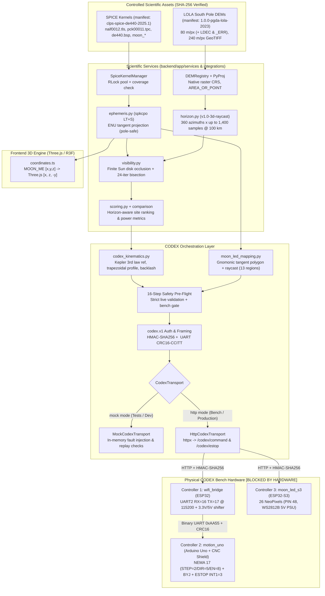

# Scientific Computing, Visualization & CODEX Hardware Reference

> **Purpose:** Complete engineering, mathematical, and safety reference for the CLPS Luna Browser's scientific computation stack (NAIF SPICE ephemeris, LOLA DEM 3D horizon raycasting, finite-disk solar/Earth visibility & event bisection, Three.js frame transform) and the physical CODEX (hardware-in-the-loop) kinetic-plus-LED architecture.
> **Audience:** Simulation engineers, embedded/mechatronics engineers, backend architects, and presenters handling physics, astronomy, geodesy, or hardware-safety cross-examination.
>
> **Verification Evidence Legend:**
> - `[VERIFIED IN SOURCE]` — Directly verified in application source files, firmware sketches, data manifests, or database migrations.
> - `[VERIFIED BY TEST]` — Verified by passing automated backend (`pytest`, 115 tests, 91% coverage; `ruff`; `mypy`) or frontend (`vitest`, 22 tests; `tsc`) checks.
> - `[DOCUMENTED, NOT INDEPENDENTLY VERIFIED]` — Recorded in project tracking reports (`PHASE_8_FINAL_VERIFICATION_REPORT.md`, `TEST_EVIDENCE_TRACKER.md`) rather than executed in the current session.
> - `[BLOCKED BY HARDWARE]` — Physical hardware bench verification is incomplete/blocked; firmware compile-time `#error` blocks are intentionally active.
> - `[NOT IMPLEMENTED]` — Absent from the codebase or explicitly deferred beyond current scope.

---

## 1. End-to-End Scientific & Hardware Pipeline Architecture



---

## 2. Astronomical Reference Systems & NAIF SPICE Pipeline

### 2.1 Controlled SPICE Kernel Manifest `[VERIFIED IN SOURCE]`

Location: [`data/spice-kernels/manifest.json`](file:///Users/siddharthwaikar/Personal/CodexBase/NASA%20Space%20App%20Challenge/CLPS%20Lunar%20Module/data/spice-kernels/manifest.json) and [`kernel_manager.py`](file:///Users/siddharthwaikar/Personal/CodexBase/NASA%20Space%20App%20Challenge/CLPS%20Lunar%20Module/backend/app/integrations/spice/kernel_manager.py)

- **Manifest Version:** `clps-spice-de440-2025.1`
- **Primary Lunar Frame:** `MOON_ME` (alias resolved to `MOON_ME_DE440_ME421`)
- **Principal Axes Frame:** `MOON_PA_DE440`
- **LSK Latest Leap Second:** `2017-01-01 (DELTA_AT=37)`
- **Required SPK Bodies verified on load:** `10 (SUN)`, `301 (MOON)`, `399 (EARTH)`
- **Required Frames verified on load:** `MOON_ME`, `MOON_PA`, `MOON_ME_DE440_ME421`, `MOON_PA_DE440`, `IAU_MOON`

| Kernel Filename | Kind | Disk Size (Bytes) | Coverage / Scope | Manifest SHA-256 Prefix | Role |
|---|---|---:|---|---|---|
| `naif0012.tls` | `LSK` | 5,257 | Leapseconds (`DELTA_AT=37`) | `678e32bd...` | UTC ↔ TDB (`str2et`) conversion |
| `pck00011.tpc` | `PCK_TEXT` | 131,226 | IAU 2015 body constants | `3dff7b1d...` | Moon / Sun / Earth radii & body constants |
| `moon_de440_250416.tf` | `FK` | 19,478 | Replaces `moon_de440_200625.tf` | `a47c71e9...` | Lunar frame kernel (`MOON_ME -> MOON_ME_DE440_ME421`) |
| `moon_assoc_me.tf` | `FK` | 8,468 | Body 301 frame binding | `52c62204...` | Associates `MOON_ME` as default `MOON (301)` frame |
| `moon_pa_de440_200625.bpc` | `PCK_BINARY` | 12,863,488 | `1549-12-31` to `2650-01-25` | `60cd55aa...` | High-precision binary lunar PA orientation kernel |
| `de440.bsp` | `SPK` | 119,799,808 | `1549-12-31` to `2650-01-25` | `a4ce9bf9...` | JPL DE440 planetary & lunar ephemeris |

### 2.2 Thread Safety, Checksums & Path Security (`SpiceKernelManager`) `[VERIFIED IN SOURCE]`

1. **Path Traversal Prevention (`_safe_kernel_path`):** Rejects filenames containing `/`, `\`, or `..`, and verifies `(self.kernel_dir / filename).resolve().parent == self.kernel_dir`.
2. **Cryptographic Integrity:** On cold load, streams every kernel in `1 MiB` chunks and verifies exact lowercase SHA-256 match against `manifest.json`. Any mismatch raises `SpiceKernelError`.
3. **Stat-Based Fast Path:** Subsequent calls check `manifest.json` `st_mtime_ns`, kernel file sizes/mtimes, and `spice.ktotal("ALL")` under a process-wide `threading.RLock()` (necessary because the underlying C library `CSPICE` maintains a non-reentrant global kernel pool).
4. **Strict Interval Coverage (`SpiceCoverageError`):** Before computing ephemerides, requested start/end UTC timestamps are converted via `spice.str2et` and checked against the common intersection window `[common_start_et, common_end_et]` (`1549-12-31` .. `2650-01-25`). Out-of-range queries raise `SpiceCoverageError` citing `valid_start_utc`, `valid_end_utc`, and `responsible_kernel`.

### 2.3 Polar-Safe Topocentric Geometry (`ephemeris.py` & `geometry.py`) `[VERIFIED IN SOURCE]`

A common pitfall when evaluating lunar polar sites (near `-90°` South Pole or `+90°` North Pole) is calling SPICE's built-in `azlcpo` or standard geographic azimuth functions directly at exact poles:

- **Why `azlcpo` Fails Near ±90°:** At `lat = ±90°`, the meridian converges to a point, causing CSPICE `azlcpo` to raise `SPICE(POINTONZAXIS)` because local East/North vectors become degenerate when normalized from Cartesian cross-products with the spin axis.
- **CLPS Luna Solution ([`ephemeris.py`](file:///Users/siddharthwaikar/Personal/CodexBase/NASA%20Space%20App%20Challenge/CLPS%20Lunar%20Module/backend/app/integrations/spice/ephemeris.py) & [`geometry.py`](file:///Users/siddharthwaikar/Personal/CodexBase/NASA%20Space%20App%20Challenge/CLPS%20Lunar%20Module/backend/app/services/geometry.py)):**
  1. Converts `(latitude_deg, longitude_deg, effective_elevation_m)` on reference radius `1,737,400.0 m` (`1,737.4 km`) into a 3D `MOON_ME` observer position vector (`obs_pos_moon_me_km`).
  2. Constructs an explicit, polar-safe local East-North-Up (`local_enu_basis`) orthonormal triad using analytical longitude trigonometric rotation even when $|\phi| \to 90^\circ$.
  3. Calls `spice.spkcpo(...)` (`observer_frame="MOON_ME"`, `abcorr="LT+S"` for planetary aberration + one-way light-time correction) for target `"SUN"` (`10`) and `"EARTH"` (`399`).
  4. Projects the returned 3D direction vector onto `[east, north, up]` via `vector_to_az_el`:
     - $\text{Elevation} = \arcsin(\text{clip}(\hat{v} \cdot \hat{u}, -1, 1))$
     - $\text{Azimuth} = \operatorname{atan2}(\hat{v} \cdot \hat{e}, \hat{v} \cdot \hat{n}) \bmod 360^\circ$ (clockwise from local North).

> **Judge Talking Point:** "Why didn't you just use `azlcpo` in SpiceyPy? Because CLPS missions focus on lunar polar regions including Shackleton Rim (`-89.68° S`) and the South Pole itself (`-90.0°`). `azlcpo` throws `SPICE(POINTONZAXIS)` at exact poles, so we use `spkcpo` with `"LT+S"` light-time/stellar aberration correction in `MOON_ME` and project onto a singularity-free analytical ENU basis."

---

## 3. LOLA Digital Elevation Models & 3D Horizon Raycasting

### 3.1 LOLA DEM Asset Manifest (`data/lunar-dem/manifest.json`) `[VERIFIED IN SOURCE]`

- **Manifest Version:** `1.0.0-pgda-lola-2023`
- **Lunar Datum:** `R = 1,737,400.0 m` in `MOON_ME` (`DE421`-aligned; sub-meter offset vs `DE440` documented).
- **Source Citation:** Barker et al. (2021, 2023), NASA GSFC PGDA LOLA South Pole Elevation Products 78 / 90.

| Asset Filename | Purpose | Dimensions / Res | Dtype | Bounds (`x, y` meters) | File Size (Bytes) | Companion Grids |
|---|---|---|---:|---|---:|---|
| `LDEM_80S_80MPP_ADJ.TIF` | Primary high-res South Pole (`≥80°S`) DEM | `7600 × 7600`, `80 m/px` | `float32` | `[-304000, -304000, 304000, 304000]` | 189,158,392 | `LDEC` + `_ERR` |
| `LDEC_80S_80MPP_ADJ.TIF` | LOLA laser shot count per pixel | `7600 × 7600`, `80 m/px` | `float32` | `[-304000, -304000, 304000, 304000]` | 115,657,642 | Paired w/ `80MPP` |
| `LDEM_80S_80MPP_ADJ_ERR.TIF` | Elevation uncertainty (`1-sigma` meters) | `7600 × 7600`, `80 m/px` | `float32` | `[-304000, -304000, 304000, 304000]` | 254,808,965 | Paired w/ `80MPP` |
| `LDEM_60S_240MPP_ADJ.TIF` | Broader South Pole fallback (`≥60°S`) | Coarse (`240 m/px`) | `float32` | Wider polar stereographic extent | 218,961,039 | None bundled |

### 3.2 Native CRS Projection & Bounded Window Loading (`DEMRegistry` + `coordinate_transform.py`) `[VERIFIED IN SOURCE]`

1. **Zero Hardcoded EPSG Assumptions:** [`coordinate_transform.py`](file:///Users/siddharthwaikar/Personal/CodexBase/NASA%20Space%20App%20Challenge/CLPS%20Lunar%20Module/backend/app/integrations/terrain/coordinate_transform.py) constructs PyProj `Transformer(..., always_xy=True)` directly from the GeoTIFF's own WKT/PROJ4 CRS and ellipsoid semi-major axis (`datum_radius_m`), honoring GDAL's `AREA_OR_POINT` tag (`"Area"` pixel-centered vs `"Point"`).
2. **Asset Selection (`select_asset_for_site`):** Checks every verified GeoTIFF's bounding polygon in projected raster `(x, y)` meters:
   - Computes `min_edge_margin_m` from site `(x, y)` to the nearest tile edge.
   - Prefers finest resolution among tiles where `min_edge_margin_m >= horizon_max_radius_m` (`100 km`, ensuring zero boundary truncation).
   - Otherwise falls back to largest edge margin, then finest pixel resolution (`LDEM_60S_240MPP_ADJ.TIF`).
   - If NO registered DEM covers the site coordinates (e.g., equatorial regions like Mare Crisium or Reiner Gamma), the simulation explicitly produces a `geometric_only` flat-sphere horizon rather than silently failing or hallucinating topography.
3. **RAM Protection (`read_window_for_site`):** Clips strictly to `±horizon_max_radius_m` (`±100 km` + 4-pixel padding), reads center pixel elevation at exact `1:1` native resolution for observer ground height, and caps large windows via `max_window_pixels_per_side = 2600` using Rasterio `out_shape` resampling while updating `win_transform` scale cleanly.

### 3.3 True 3D Spherical-Curved Horizon Raycasting (`horizon.py`) `[VERIFIED IN SOURCE]`

Location: [`backend/app/services/horizon.py`](file:///Users/siddharthwaikar/Personal/CodexBase/NASA%20Space%20App%20Challenge/CLPS%20Lunar%20Module/backend/app/services/horizon.py) (`HORIZON_ALGORITHM_VERSION = "v1.0-3d-raycast"`)

Flat-plane trig (`atan2(dz, d)`) severely overestimates horizon visibility over `100 km` lunar distances because lunar curvature drop is $\approx d^2 / (2 R_{\text{Moon}}) \approx 2,877\text{ m}$ at $100\text{ km}$! Therefore CLPS Luna uses **full 3D lunar-centered vector raycasting**:

- **Default Raycast Parameters:**
  - `observer_height_m = 1.5 m` (representative CLPS lander deck / mast sensor height above local regolith)
  - `min_radius_m = 50.0 m`, `max_radius_m = 100,000.0 m` (`100 km`)
  - `azimuth_bins = 360` (`1°` resolution, `0°..359°`)
  - `max_radial_samples = 1400` per ray
- **3D Curved Surface Ray Geometry:**
  1. Observer radial distance: $r_{\text{obs}} = R_{\text{datum}} + h_{\text{ground}} + h_{\text{obs}}$, position vector $\vec{p}_{\text{obs}} = r_{\text{obs}} \hat{u}_{\text{obs}}$.
  2. Along each azimuth $\alpha$, horizontal ENU unit tangent direction is $\hat{d}_{\text{horiz}} = \sin\alpha\,\hat{e} + \cos\alpha\,\hat{n}$.
  3. At arc distance $s$, central lunar angle $\sigma = s / R_{\text{datum}}$, giving the terrain radial direction vector:
     $$\hat{u}_2(\sigma) = \cos\sigma\,\hat{u}_{\text{obs}} + \sin\sigma\,\hat{d}_{\text{horiz}}$$
  4. Sample point geographic `(lon, lat)` is converted from $\hat{u}_2$ into raster pixel `(col, row)` using the GeoTIFF CRS transformer and bilinearly interpolated from `elevation_m` (`z`, `count_grid`, `error_m_grid`).
  5. Terrain 3D Cartesian point $\vec{p}_{\text{terr}} = (R_{\text{datum}} + z)\hat{u}_2$, line-of-sight vector $\vec{v} = \vec{p}_{\text{terr}} - \vec{p}_{\text{obs}}$.
  6. Topocentric vertical component $v_u = \vec{v} \cdot \hat{u}_{\text{obs}}$ and horizontal projection distance $v_h = \|\vec{v} - v_u \hat{u}_{\text{obs}}\|$ yield exact horizon elevation angle:
     $$\theta_{\text{hor}} = \operatorname{atan2}(v_u, \max(v_h, 10^{-6}))$$
- **Uncertainty & Data-Quality Propagation:**
  - When `_ERR` grid is present, combines observer pixel error (`obs_err`) and peak-blocking ridge pixel error (`ridge_err`) in quadrature: $\sigma_{\text{comb}} = \sqrt{\sigma_{\text{obs}}^2 + \sigma_{\text{ridge}}^2}$, propagated into angular uncertainty $\sigma_\theta = \operatorname{deg}(\sigma_{\text{comb}} / \max(d_{\text{horizon}}, r_{\text{start}}))$.
  - When `LDEC` (shot count) shows `zero_shot_frac > 0.5` (`LDEC = 0`, meaning >50% of sampled ridge/terrain points are interpolated without direct LOLA laser altimetry shots), attaches explicit quality warnings (`interpolated_low_shot_density`) rather than hiding interpolation artifacts.
- **Persistent Cache Key:** Deterministic SHA/key incorporating `(site_id, lat_deg, lon_deg, site_db_elevation_m, dem_asset_id, dem_checksum, coordinate_frame, observer_height_m, algorithm_version, azimuth_bins, max_radius_m)` stored in `terrain_horizon_profiles`.

---

## 4. Solar & Earth Visibility Modeling, Event Bisection & Site Scoring

### 4.1 Finite Solar Disk Segment Occlusion (`visibility.py`) `[VERIFIED IN SOURCE]`

Location: [`backend/app/services/visibility.py`](file:///Users/siddharthwaikar/Personal/CodexBase/NASA%20Space%20App%20Challenge/CLPS%20Lunar%20Module/backend/app/services/visibility.py)

Unlike naive binary horizon models that treat the Sun as a point source, CLPS Luna models the **angular radius of the solar disk** (`SUN_RADIUS_KM = 695,700.0 km`, giving ~`0.266°` angular radius, ~`0.53°` apparent diameter from the Moon; `EARTH_MEAN_RADIUS_KM = 6,371.0 km`, giving ~`0.95°` angular radius):

1. Computes instantaneous angular radius $\rho = \arcsin(\min(1, R_{\text{body}} / d_{\text{range}}))$ in degrees.
2. Interpolates local terrain horizon angle $\theta_{\text{hor}}(\alpha)$ at solar azimuth $\alpha$ from the 360-bin horizon profile.
3. Let clearance $c = \theta_{\text{center}} - \theta_{\text{hor}}(\alpha)$:
   - If $c \ge \rho$: visible fraction $f = 1.0$ (`day` / full illumination).
   - If $c \le -\rho$: visible fraction $f = 0.0$ (`night` / eclipsed by crater rim or curvature).
   - If $|c| < \rho$ (`partial_occlusion` / sunrise–sunset transition): exact circular segment area fraction using dimensionless signed height $x = c / \rho \in (-1, 1)$:
     $$f = \frac{\arccos(-x) + x\sqrt{1 - x^2}}{\pi}$$
4. For Earth line-of-sight (critical for Direct-to-Earth X-band / S-band CLPS communications without a lunar relay satellite), computes clearance relative to `EARTH_MEAN_RADIUS_KM` (`earth_visible_fraction`, DTE visibility windows).

### 4.2 Two-Stage Coarse Sampling + Root Bisection (`_bisect_bracket`) `[VERIFIED IN SOURCE]`

Location: [`backend/app/services/visibility.py`](file:///Users/siddharthwaikar/Personal/CodexBase/NASA%20Space%20App%20Challenge/CLPS%20Lunar%20Module/backend/app/services/visibility.py) and [`app/core/config.py`](file:///Users/siddharthwaikar/Personal/CodexBase/NASA%20Space%20App%20Challenge/CLPS%20Lunar%20Module/backend/app/core/config.py)

- **Hard Operational Bounds:**
  - `SIM_DEFAULT_COARSE_INTERVAL_SECONDS = 900` (15-minute steps)
  - `SIM_MAX_COARSE_SAMPLES = 20,000` samples max per run
  - `SIM_MAX_DURATION_SECONDS = 315,360,000` (~10 Earth years max simulation span)
- **Why Naive Fixed-Step Integration Fails for Events:** At a 15-minute step, exact sunrise, sunset, or DTE LOS/AOS transitions would have up to ±15 min timing error, or miss grazing crater-rim skims.
- **CLPS Bisection Solver:** Whenever a sign change in visibility clearance occurs between coarse epochs $[t_k, t_{k+1}]$, `_bisect_bracket` runs binary bisection re-evaluating exact SPICE ephemeris (`spkcpo`) + horizon interpolation until:
  - bracket width $\Delta t \le \text{tol\_seconds} = 1.0\text{ s}$, OR
  - `max_iters = 24` iterations complete ($900\text{ s} / 2^{24} \approx 5.4 \times 10^{-5}\text{ s}$ resolution, well inside `1.0 s`).
- Events are persisted in `simulation_event_windows` (`sunrise_start`, `sunrise_end`, `sunset_start`, `sunset_end`, `earth_rise`, `earth_set`, etc.) with exact UTC timestamp, angular elevation, azimuth, and refined accuracy metadata.

### 4.3 Three.js Coordinate Transform (`coordinates.ts`) `[VERIFIED IN SOURCE]`

Location: [`frontend/src/three/coordinates.ts`](file:///Users/siddharthwaikar/Personal/CodexBase/NASA%20Space%20App%20Challenge/CLPS%20Lunar%20Module/frontend/src/three/coordinates.ts) (verified by `coordinates.test.ts`)

NAIF SPICE `MOON_ME` is right-handed with `+Z` pointing toward the **Lunar North Pole**, `+X` toward **0° longitude** (sub-Earth mean prime meridian), and `+Y` toward **90° E**. Three.js uses a right-handed `Y-up` graphics world (`+Y` North). Performing axis flips ad-hoc causes mirrored longitudes (east/west reversal) or flipped poles.

Therefore, **one canonical transform** (`spiceMoonMeToThree`) is enforced across Moon globe rotation, landing site pins, sun direction vector, and Earth direction vector:

$$\begin{bmatrix} x_{\text{Three}} \\ y_{\text{Three}} \\ z_{\text{Three}} \end{bmatrix} = s \cdot \begin{bmatrix} x_{\text{ME}} \\ z_{\text{ME}} \\ -y_{\text{ME}} \end{bmatrix}$$

Check right-handedness ($\det = +1$): $\hat{e}_x \times \hat{e}_y = (1,0,0) \times (0,0,1)$? Verify: $(1,0,0) \times (0,1,0) = (0,0,1)$ maps from `MOON_ME` $(\hat{X}, \hat{Z}, -\hat{Y})$: $\det\begin{pmatrix}1&0&0\\0&0&1\\0&-1&0\end{pmatrix} = +1$ (strictly preserves right-handedness without mirroring crater chirality!).

---

## 5. CODEX Kinetics, Moon LED Mapping & Template Engine

The **CODEX subsystem** connects validated lunar simulations to a three-controller physical Earth-Moon-Sun demonstration & LED site beacon model. **Strictly software-verified to date (`[BLOCKED BY HARDWARE]` on physical bench).**

### 5.1 Astronomical Time vs. Physical Bench Time Separation (`codex_kinematics.py`) `[VERIFIED IN SOURCE]`

Location: [`backend/app/services/codex_kinematics.py`](file:///Users/siddharthwaikar/Personal/CodexBase/NASA%20Space%20App%20Challenge/CLPS%20Lunar%20Module/backend/app/services/codex_kinematics.py)

A lunar day lasts `29.530589` Earth days (`~2.55 million seconds`). Directly driving motors at real-time speed or arbitrary `playback_speed` without clamping would either stall stepper interrupts for weeks or command destructive multi-thousand-Hz step spikes!

1. **Independent Reference Math (`compute_kepler_orbital_reference`):**
   - `LUNAR_SIDEREAL_PERIOD_DAYS = 27.321661`
   - `LUNAR_SYNODIC_PERIOD_DAYS = 29.530589`
   - `EARTH_MOON_MU_KM3_S2 = 403503.2355022388`
   - `EARTH_MOON_SEMI_MAJOR_KM = 384400.0`
   - Evaluates ideal Kepler 3rd Law period $T = 2\pi\sqrt{a^3 / \mu}$ and orbital sweep fraction purely for scientific telemetry.
2. **Bounded Physical Window (`resolve_physical_duration_seconds`):**
   - Strictly decouples SPICE duration from hardware actuation time: enforces `5 s <= physical_duration_seconds <= 300 s` (`MIN_PHYSICAL_DURATION_SECONDS = 5`, `MAX_PHYSICAL_DURATION_SECONDS = 300`).

### 5.2 Stepper Motion & Trapezoidal Velocity Profile (`compute_motor_move_plan`) `[VERIFIED IN SOURCE]`

Location: [`backend/app/services/codex_kinematics.py#L286-L360`](file:///Users/siddharthwaikar/Personal/CodexBase/NASA%20Space%20App%20Challenge/CLPS%20Lunar%20Module/backend/app/services/codex_kinematics.py#L286-L360)

1. **Bench Calibration Enforcement:** When `require_verified=True` (mandatory during `/execute`, relaxed only in preview `/prepare` if `allow_unverified_preview=True`), rejects any motor profile whose `verification_status != "bench_verified"`.
2. **Offset & Hard Software Travel Limits:** Applies `zero_offset_deg` and checks `[travel_min_deg, travel_max_deg]`; rejects `travel_limit_violation` unless explicit clamping was authorized during preview.
3. **Microstep & Gear Conversion:**
   $$\text{steps\_per\_rev} = \text{full\_steps\_per\_rev} \times \text{microsteps} \times \text{gear\_reduction\_ratio}$$
   $$\text{base\_steps} = \operatorname{round}\left(\frac{|\Delta\theta|}{360^\circ} \cdot \text{steps\_per\_rev}\right)$$
   Adds configured `backlash_steps` when `base_steps > 0` and `backlash_steps > 0`.
4. **Trapezoidal vs. Triangular Acceleration Profile (`_compute_trapezoidal_profile`):**
   - Given max step rate $v_{\max}$ (`steps/s`) and acceleration $a$ (`steps/s^2`):
   - Compares `total_steps` against $v_{\max}^2 / a$:
     - If $\text{total\_steps} \le v_{\max}^2 / a$: **Triangular profile** (`cruise_steps = 0`, peak rate $v_{\text{peak}} = \sqrt{\text{total\_steps}\cdot a}$, $t_{\min} = 2\sqrt{\text{total\_steps} / a}$).
     - Otherwise: **Trapezoidal profile** (`accel_steps = floor(0.5 * v_max^2 / a)`, `decel_steps = accel_steps`, `cruise_steps = total_steps - 2*accel_steps`, $t_{\min} = 2 v_{\max}/a + \text{cruise\_steps}/v_{\max}$).
   - Rejects (`acceleration_time_exceeded`) if `permitted_move_seconds + 1e-9 < min_time`, or (`max_step_rate_exceeded`) if average step rate exceeds $v_{\max}$.

### 5.3 Moon Globe 13-Region LED Resolution (`moon_led_mapping.py`) `[VERIFIED IN SOURCE]`

Location: [`backend/app/services/moon_led_mapping.py`](file:///Users/siddharthwaikar/Personal/CodexBase/NASA%20Space%20App%20Challenge/CLPS%20Lunar%20Module/backend/app/services/moon_led_mapping.py)

Maps any lunar `(latitude_deg, longitude_deg)` landing site onto one of **13 discrete Moon globe regions** controlling a `26`-LED WS2812B strip on `moon_led_s3` (`LED_COUNT = 26`):

1. **Why Flat Lon/Lat Polygons Fail Near ±90°:** Naive 2D `(lon, lat)` polygon tests distort horribly near the South Pole (`-90°`) and fail across the `±180°` antimeridian wrap!
2. **CLPS Solution (Centroid Gnomonic Tangent Projection + Raycast):**
   - Converts polygon vertices & query site to 3D unit vectors on the Moon sphere.
   - Projects vertices onto the local **gnomonic tangent plane** centered at each region's spherical centroid `(centroid_lat, centroid_lon)` (rejecting hemispheres facing away from centroid where $\hat{p} \cdot \hat{c} \le 0$).
   - Checks point-to-edge distance within `BOUNDARY_EPSILON = 1e-6` first (breaking exact shared-border ties deterministically by **lowest `region_index`**).
   - Runs planar even-odd raycasting to confirm interior inclusion.
   - Only if `allow_centroid_led_fallback=True` (preview mode only — strictly `False` in `POST /api/v1/codex/runs`) may it fall back to `approximate_centroid_only` nearest-angular distance (`allow_centroid_led_fallback=False` blocks unverified polygon mappings before real actuation).
   - Reads normalized pixels from `moon_led_region_pixels` (`pixel_index`, `output_channel`, `pixel_order`, `topology_mode`) with explicit RGB preset colors per hardware state.

### 5.4 Firmware Template Allow-List Engine (`codex_template_engine.py`) `[VERIFIED IN SOURCE]`

Location: [`backend/app/services/codex_template_engine.py`](file:///Users/siddharthwaikar/Personal/CodexBase/NASA%20Space%20App%20Challenge/CLPS%20Lunar%20Module/backend/app/services/codex_template_engine.py)

Enables the Admin Portal split-pane firmware editor (`AdminFirmwareEditorPage`) to parameterize C++/Arduino headers (`Wi-Fi SSID` placeholders, pins, speeds, LED counts) **without C injection vulnerabilities**:

- Only matches exact `{{UPPER_SNAKE_CASE}}` tokens (`\{\{([A-Z0-9_]+)\}\}`).
- Validates every substituted token against its DB `placeholder_schema` min/max integer/float bounds or regex pattern.
- **Explicit C Injection Denylist (`UNSAFE_C_FRAGMENTS`):** Rejects any parameter value containing `\n`, `\r`, `;`, `#include`, `#define`, `/*`, `*/`, `//`, `"`, `'`, or `\`.
- Emits deterministic SHA-256 checksum (`compute_sha256_hex`) for diffing and audit logs.

---

## 6. CODEX Wire Protocol, Three-Controller Firmware & Safety Controls

### 6.1 Command `codex.v1` Signed Envelope (`protocol.py`) `[VERIFIED IN SOURCE]`

Location: [`backend/app/integrations/codex/protocol.py`](file:///Users/siddharthwaikar/Personal/CodexBase/NASA%20Space%20App%20Challenge/CLPS%20Lunar%20Module/backend/app/integrations/codex/protocol.py)

- **Protocol Identifier:** `codex.v1`
- **Canonical HMAC Signing Input:**
  ```text
  "{command_id}.{issued_at_utc}.{nonce}.{sequence_number}.{canonical_sorted_compact_json_body}"
  ```
  Signed via `HMAC-SHA256(CODEX_SHARED_SECRET, signing_input)`.
- **Authentication & Replay Headers:**
  - `X-Codex-Protocol: codex.v1`
  - `X-Codex-Command-Id: <UUID>`
  - `X-Codex-Timestamp: <ISO8601 UTC>`
  - `X-Codex-Nonce: <24-byte URL-safe random token>` (stored in PostgreSQL `codex_command_nonces` with TTL cleanup + controller-side ring buffer)
  - `X-Codex-Sequence: <monotonic 64-bit integer>`
  - `X-Codex-Signature: <64-char hex HMAC-SHA256>`
- **Secret Redaction:** `redact_sensitive_mapping` masks signatures/secrets before storing command telemetry or writing audit/structured logs.

### 6.2 ESP32 Bridge ↔ Arduino Uno Binary UART Protocol `[VERIFIED IN SOURCE]`

Because the Arduino Uno (ATmega328P) lacks Wi-Fi and hardware TLS/HMAC capacity, the ESP32 Wi-Fi Bridge verifies HMAC-SHA256 over HTTP and relays deterministic binary frames over `UART2` (`GPIO 16 RX / GPIO 17 TX`, `115200 baud`, **requiring a bidirectional 3.3V ↔ 5V logic level shifter**):

| Byte Offset | Size | Field | Value / Encoding |
|---:|---:|---|---|
| `0..1` | 2 B | `SOF` | `0xAA55` (little-endian: bytes `0x55, 0xAA`) |
| `2` | 1 B | `version` | `0x01` (`UART_VERSION`) |
| `3` | 1 B | `msg_type` | `0x01=PING`, `0x02=MOTION_CMD`, `0x03=ESTOP`, `0x04=STATUS_REQ`, `0x81=ACK`, `0x82=NACK`, `0x83=FAULT`, `0x84=TELEMETRY` |
| `4..7` | 4 B | `seq` | Unsigned 32-bit LE sequence (`uint32`) |
| `8..9` | 2 B | `len` | Payload length `<= 256` bytes (`uint16` LE) |
| `10..10+len-1` | `len` B | `payload` | ASCII command `"N:{dir}:{steps}:{us}\|B:{dir}:{steps}:{us}\|T:{dur}"` |
| `10+len..11+len` | 2 B | `CRC16-CCITT` | Computed over `frame[2 .. 10+len-1]`, poly `0x1021`, init `0xFFFF` |

Python packing: `<HBBIH` header + payload + `<H` CRC (`protocol.py`). Bridge waits `500 ms` for a valid CRC-verified `ACK`/`NACK`/`FAULT` response frame.

### 6.3 Three Hardware Controllers & Pin Assignments `[VERIFIED IN SOURCE]`

| Controller Key | MCU / Role | Communications | Verified Pinout & Key Constants | Compile-Time Safety Guard Status |
|---|---|---|---|---|
| `wifi_bridge` | **ESP32 DevKit** (`esp32-wifi-bridge.ino`) | HTTP `:80` (`/health`, `/codex/command`, `/codex/estop`) + `UART2` to Uno | `UART2 RX = GPIO 16`, `TX = GPIO 17` @ `115200` baud; 16-entry nonce ring buffer (`NONCE_RING_SIZE`) | **No `#error` guard** in `.ino` (requires local `secrets.h` copied from `secrets.example.h`) |
| `motion_uno` | **Arduino Uno R3 + CNC Shield v3** (`arduino-uno-motion.ino`) | Hardware `Serial` (`115200`) from ESP32 Bridge via **3.3V↔5V shifter** | **NEMA17:** `STEP=2`, `DIR=5`, `EN=8` (active-LOW); **BYJ:** `STEP=4/DIR=7` or `IN1..4=10,11,12,13`; **ESTOP:** `Pin 3` (`INT1` FALLING, `INPUT_PULLUP`); **Limit Switch:** `Pin 9`; `MAX_ALLOWED_COMMAND_STEPS = 200000L`; `WDTO_2S` hardware watchdog | **`#error` ACTIVE (`[BLOCKED BY HARDWARE]`):** Must select `BYJ_DRIVER_ULN2003_4WIRE` OR `BYJ_DRIVER_BIPOLAR_STEP_DIR` in `config.h` after bench verification |
| `moon_led_s3` | **ESP32-S3** (`esp32-s3-moon-led.ino`) | Direct HTTP `:80` (`/health`, `/codex/command`, `/codex/estop`) | `LED_DATA_PIN = 48`, `LED_COUNT = 26`, `NEO_GRB + NEO_KHZ800` (Adafruit NeoPixel over dedicated external 5V PSU) | **`#error` ACTIVE (`[BLOCKED BY HARDWARE]`):** Must define `BENCH_VERIFIED_LED_TOPOLOGY` in `secrets.h` after wiring inspection |

---

## 7. 16-Step Safety Pre-Flight & `mock` vs `http` Execution Modes `[VERIFIED IN SOURCE]`

Before **any** hardware run executes (`POST /api/v1/codex/runs`), `codex_service.py` enforces `confirmed = true` and runs `_evaluate_16_step_preflight(..., allow_unverified_preview=False, allow_centroid_led_fallback=False)` live at execution time:

| Step | Key | Mode / Scope | Exact Pass Criteria & Safety Justification |
|---:|---|---|---|
| **1** | `site_published` | All modes | Site exists and `catalogue_status == "published"`. |
| **2** | `simulation_valid` | All modes | Simulation run exists, matches `site_id`, and `status == "completed"`. |
| **3** | `time_parameters_valid` | All modes | `resolve_physical_duration_seconds` succeeds (`5s..300s`) and Kepler reference computes cleanly. |
| **4** | `device_inventory_present` | `target_controllers` (`3` in `full_codex`, `1` `moon_led_s3` in `led_only`) | Every required controller row exists in `hardware_devices`. |
| **5** | `device_heartbeat_fresh` | `target_controllers` | Every target controller responded within configured heartbeat TTL. |
| **6** | `device_verification_status` | `target_controllers` | When `CODEX_REQUIRE_VERIFIED_BENCH=true`, requires `verification_status == "bench_verified"` on every target controller. |
| **7** | `firmware_version_match` | `target_controllers` | `effective_state != "firmware_mismatch"` (reported sketch matches DB config). |
| **8** | `bridge_uart_link_ok` | Bypassed in `led_only` | `wifi_bridge.uart_ok` and `motion_uno.uart_ok` are both `True`. |
| **9** | `configuration_present` | `target_controllers` | Active `hardware_configurations` baseline exists and matches device (`effective_state != "configuration_mismatch"`). |
| **10** | `nema17_calibration_valid` | Skipped in `led_only` | Active `nema17` `motor_calibration_profiles` exists & verified if `strict_bench=True`. |
| **11** | `byj_calibration_valid` | Skipped in `led_only` | Active `byj` `motor_calibration_profiles` exists & verified if `strict_bench=True`. |
| **12** | `kinematics_within_limits` | Skipped in `led_only` | Both NEMA17 and BYJ trapezoidal profiles pass travel, max step rate, and acceleration bounds without clamping. |
| **13** | `led_mapping_valid` | All modes | Active 1..13 `moon_led_regions` + normalized pixels resolve via exact gnomonic polygon without unverified fallback. |
| **14** | `estop_not_latched` | All modes | No target controller reports `estop_latched == True`. |
| **15** | `replay_and_ttl_ready` | All modes | `CODEX_SHARED_SECRET` configured & non-placeholder for production dispatch, `CODEX_COMMAND_TTL_SECONDS > 0`. |
| **16** | `operator_confirmation_policy` | Execute gate | Two-step confirmation (`prepare` -> `confirmed=true` in `/execute` + unique `idempotency_key`). |

> **Critical Transport Abstraction:** Switching `CODEX_TRANSPORT_MODE=mock` uses [`MockCodexTransport`](file:///Users/siddharthwaikar/Personal/CodexBase/NASA%20Space%20App%20Challenge/CLPS%20Lunar%20Module/backend/app/integrations/codex/client.py#L99-L318), which validates real HMAC-SHA256 signatures, nonce uniqueness, monotonic sequences, and `<HBBIH` + CRC16-CCITT UART decoding **in memory** while allowing fault injection (`timeout`, `offline`, `reject_hmac`, `uart_failure`, `simulate_fault`) without hardware connected. Switching to `http` uses [`HttpCodexTransport`](file:///Users/siddharthwaikar/Personal/CodexBase/NASA%20Space%20App%20Challenge/CLPS%20Lunar%20Module/backend/app/integrations/codex/client.py#L321-L478).

---

## 8. Verified Discrepancies, Hardware Safety Blockers & Engineering Honesty

In full transparency for team review and jury cross-examination, **do not conceal these verified findings** observed directly in the repository:

### 8.1 Firmware-to-Backend Integration Defects Found in Source `[VERIFIED IN SOURCE]`

1. **`HttpCodexTransport._post_command` Mutates Body After Signing ([`client.py:402`](file:///Users/siddharthwaikar/Personal/CodexBase/NASA%20Space%20App%20Challenge/CLPS%20Lunar%20Module/backend/app/integrations/codex/client.py#L402)):**
   - `codex_service.py` calls `build_signed_headers(secret, cmd_payload)` **before** transport dispatch (`codex_service.py:1387`).
   - Inside `HttpCodexTransport._post_command`, if `uart_frame is not None`, it copies `body = dict(command_payload)` and injects `body["uart_frame_hex"] = uart_frame.hex()` **after** the HMAC signature was already computed over the body without `uart_frame_hex`.
   - **Impact:** Works in `MockCodexTransport` (which doesn't run `_post_command`), **fails HMAC verification against real ESP32 hardware** unless `uart_frame_hex` is included before signing or transmitted outside the signed JSON body.
2. **ESP32 Unsorted `ArduinoJson` Re-Serialization ([`esp32-wifi-bridge.ino:188`](file:///Users/siddharthwaikar/Personal/CodexBase/NASA%20Space%20App%20Challenge/CLPS%20Lunar%20Module/firmware/esp32-wifi-bridge/esp32-wifi-bridge.ino#L188), [`esp32-s3-moon-led.ino:92`](file:///Users/siddharthwaikar/Personal/CodexBase/NASA%20Space%20App%20Challenge/CLPS%20Lunar%20Module/firmware/esp32-s3-moon-led/esp32-s3-moon-led.ino#L92)):**
   - Backend signs compact **alphabetically key-sorted** JSON (`sort_keys=True, separators=(",", ":")`), whereas both ESP32 sketches call `serializeJson(doc, canonical_body)` in insertion order (without sorting keys), causing key-order mismatches on nested objects during live ESP32 verification. *(Workaround/fix for future Phase 5 hardware bench: sign raw HTTP payload bytes with timestamp/nonce/seq headers or sort keys recursively on ESP32).*
3. **ESP32 `/codex/estop` Handlers Omit HMAC Verification Call ([`esp32-wifi-bridge.ino:272`](file:///Users/siddharthwaikar/Personal/CodexBase/NASA%20Space%20App%20Challenge/CLPS%20Lunar%20Module/firmware/esp32-wifi-bridge/esp32-wifi-bridge.ino#L272), [`esp32-s3-moon-led.ino:175`](file:///Users/siddharthwaikar/Personal/CodexBase/NASA%20Space%20App%20Challenge/CLPS%20Lunar%20Module/firmware/esp32-s3-moon-led/esp32-s3-moon-led.ino#L175)):**
   - Although `verify_request_hmac(doc, true)` exists specifically with an `allow_estop_bypass_seq = true` mode for emergency stops, `handle_estop()` on both ESP32 sketches immediately trips E-STOP on any `POST /codex/estop` without calling `verify_request_hmac(doc, true)` first! (An unauthenticated attacker on the LAN could trigger spurious E-STOPs—safe fail-closed direction, though missing LAN authentication).

### 8.2 Phase 5 Hardware Bench Blockers `[BLOCKED BY HARDWARE]`

Per [`PHASE_8_FINAL_VERIFICATION_REPORT.md`](file:///Users/siddharthwaikar/Personal/CodexBase/NASA%20Space%20App%20Challenge/CLPS%20Lunar%20Module/docs/project_tracking/PHASE_8_FINAL_VERIFICATION_REPORT.md):
- **`RSK-HW-01` / `AUD-07`:** Neither `arduino-cli` nor `pio` (PlatformIO) is installed on the host, and no physical ESP32, Arduino Uno, stepper motors, 3.3V↔5V level shifter, or 26-LED NeoPixel Moon globe are attached.
- **Active Compile Guards:** `arduino-uno-motion.ino:16` (`BYJ_DRIVER_ULN2003_4WIRE` vs `BIPOLAR`) and `esp32-s3-moon-led.ino:17` (`BENCH_VERIFIED_LED_TOPOLOGY`) intentionally fail compilation until bench wiring is physically inspected.
- **Physical Calibration Unmeasured:** Stepper `backlash_steps`, `gear_reduction_ratio`, `zero_offset_deg`, `travel_min/max_deg`, and Moon globe LED `mapping_version` values in PostgreSQL are seed/prototype estimates requiring physical measurement on the mechanical rig before production bench unlock.
